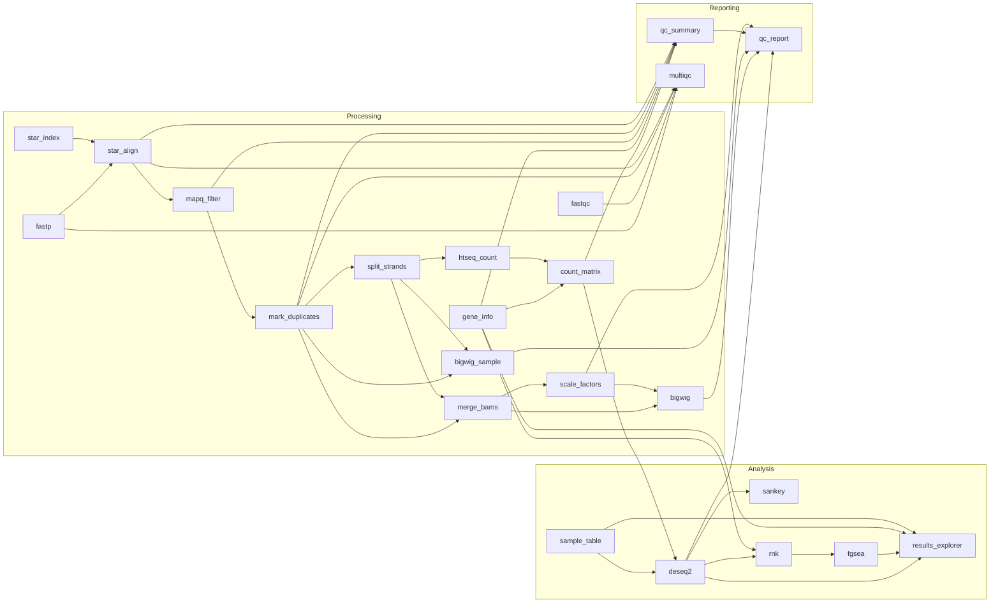

# TTpipe code guide

What each part of the codebase does, what it reads and writes, and how the
steps connect. For running the pipeline, see [`README.md`](README.md).

---

## Overview

### What this pipeline does

TTpipe processes **TT-seq (TTchem-seq)** data: sequencing of RNA that was
newly made during a short pulse of 4-thiouridine (4sU) labeling. It takes
paired-end FASTQ files and produces alignments, strand-specific bigWig
tracks, per-gene counts over the whole gene body, differential expression
(DESeq2), preranked gene-set enrichment (fgsea), a Sankey diagram, and a QC
report.

It is a **reimplementation** of the TT-seq workflow described in a pipeline
guide for Magnitov et al. 2024, *Mol Cell*
(doi 10.1016/j.molcel.2024.11.031; GEO GSE260914; the authors' code is at
<https://github.com/magnitov/zfp143>). It is not the authors' code. The tool
choices and parameters follow the guide; where the code does something
different on purpose, it is in the table
[Deliberate changes from the source workflow](#deliberate-changes-from-the-source-workflow).
The layout (samplesheet, config, SLURM profiles, per-rule conda
environments, static QC report) follows PhanstielLab's dietJuicer and the
author's MicroCPipe.

### What is and is not tested

- The conda environments were solved on one Linux cluster. They were not
  solved on osx-arm64: STAR 2.7.9a, samtools 1.12 and HTSeq 0.13.5 have no
  arm64 builds.
- The DESeq2, fgsea and Sankey code was written without being run locally.
  `tests/test_analysis_scripts.py` tests the pure-R helpers
  (`scripts/tt_analysis_utils.R`) only.
- Resource numbers in `profiles/*/config.yaml` are starting guesses.
- `pytest tests` and CI use synthetic files and placeholder fixtures and run
  Snakemake dry runs. No tool is executed on real data by the tests.
- A real-data test on a cluster is in progress; its record is
  [`docs/validation.qmd`](docs/validation.qmd).

### Data flow

```
samplesheet.txt  (one row per sample)
    |  fastqc          FastQC on the raw FASTQs                 qc/fastqc/{sample}_R{1,2}_fastqc.zip
    |  [fastp]         optional trimming (trim: true)           {sample}/trim/*.fastq.gz   (temporary)
    v  star_align      STAR --quantMode GeneCounts              {sample}/star/..._Aligned.sortedByCoord.out.bam (temporary)
                                                                {sample}/stats/{sample}_Log.final.out, _ReadsPerGene.out.tab
    v  mapq_filter     samtools view -q min_mapq                {sample}/{sample}_mapq.bam (temporary), stats/{sample}_mapq.txt
    v  mark_duplicates Picard REMOVE_DUPLICATES, samtools index {sample}/{sample}.bam(.bai), stats/{sample}_dedupMetrics.txt, _final_pairs.txt
    v  split_strands   samtools view -f/-F (two sets) + merge   {sample}/{sample}_forward.bam, _reverse.bam (.bai)
    |
    +--> htseq_count   htseq-count --type gene                  {sample}/counts/{sample}_{forward,reverse}.counts.txt
    |       v  count_matrix  merge, drop __ rows                counts/counts_forward.txt, counts_reverse.txt, counts_deseq2.txt
    |
    +--> merge_bams    replicates per condition                 merged/{condition}[_forward|_reverse].bam
            v  scale_factors  max / this                        tracks/scale_factors.tsv
            v  bigwig         bamCoverage --scaleFactor         tracks/{condition}[_forward|_reverse].bw

GTF --> gene_info                                               counts/gene_info.tsv
samplesheet --> sample_table                                    counts/samples_deseq2.txt

counts_deseq2.txt + samples_deseq2.txt --> deseq2               analysis/deseq2/degs_*.csv, deg_summary.tsv, normalized_counts.tsv, vst.tsv, figures/pca.pdf
degs_*.csv + gene_info --> rnk --> fgsea                        analysis/gsea/{comparison}.rnk, {collection}_{comparison}.tsv
degs_*.csv --> sankey                                           analysis/figures/sankey.pdf, analysis/deseq2/sankey_categories.tsv
DEG tables + gene_info + normalized counts [+ fgsea] --> results_explorer   analysis/TTpipe_results_explorer.html
everything --> qc_summary --> qc_report                         qc/sample_qc.tsv, qc/TTpipe_qc_report.html
FastQC, [fastp], STAR, Picard --> multiqc                       qc/TTpipe_multiqc.html
```

### The rule graph

Each box is a rule, each arrow a dependency. It is generated from the real
Snakefile (`snakemake --rulegraph`) by `python scripts/make_dag.py` and is
checked against the code by `tests/test_dag.py`; never edit it by hand. All
optional branches are switched on (`trim`, `build_star_index`,
`sample_tracks`, a GSEA collection).

<!-- dag:start -->

<!-- dag:end -->

Plain-text version of the same graph (for PDF exports, which do not render
Mermaid; each line is a rule and the rules it waits for):

```text
Full workflow (all optional branches on) (generated by scripts/make_dag.py; do not edit)

PROCESSING
  fastqc           <- (inputs from the samplesheet / config)
  mark_duplicates  <- mapq_filter
  mapq_filter      <- star_align
  star_align       <- fastp, star_index
  fastp            <- (inputs from the samplesheet / config)
  star_index       <- (inputs from the samplesheet / config)
  split_strands    <- mark_duplicates
  bigwig           <- merge_bams, scale_factors
  merge_bams       <- mark_duplicates, split_strands
  scale_factors    <- merge_bams
  bigwig_sample    <- mark_duplicates, split_strands
  count_matrix     <- gene_info, htseq_count
  htseq_count      <- split_strands
  gene_info        <- (inputs from the samplesheet / config)

ANALYSIS
  sample_table     <- (inputs from the samplesheet / config)
  deseq2           <- count_matrix, sample_table
  sankey           <- deseq2
  fgsea            <- rnk
  rnk              <- deseq2, gene_info

REPORTING
  qc_report        <- bigwig, bigwig_sample, deseq2, qc_summary, scale_factors
  qc_summary       <- count_matrix, gene_info, mapq_filter, mark_duplicates, star_align
  multiqc          <- fastp, fastqc, mark_duplicates, star_align
```

The processing-only and analysis-only graphs are in
`docs/img/dag_processing.mmd` and `docs/img/dag_analysis.mmd` (and `.txt`).

### Setup and launch

1. **`samplesheet.txt`**: one tab-separated row per sample. `Name`,
   `Condition`, `Replicate` always; `Read1`, `Read2`,
   `Sequencing_Directory` when `run_processing` is true.
2. **`config/TTpipeConfig.yaml`**: reference, switches, strandedness,
   tracks, counts, DESeq2, GSEA, QC thresholds. See
   [`docs/configuration.qmd`](docs/configuration.qmd) for every key.
3. **`profiles/<site>/`**: the compute site, chosen by `--profile`, then
   `$TTPIPE_PROFILE`, then `hpcProfile` in the config.
4. **Per-cluster environment variables** (in `~/.bashrc`, outside git):
   `TTPIPE_PROFILE` picks the profile; `TTPIPE_OUTPUT_ROOT` is the folder a
   relative `outputDir` goes under; `TTPIPE_EMAIL` is the notification
   address; `TTPIPE_CONDA_ROOT` is where Miniforge lives if it is not
   `$HOME/miniforge3`.

```bash
sbatch TTpipe.sh          # whole workflow
bash TTpipe.sh -n         # dry run
bash unlock.sh            # release the Snakemake lock
```

---

## Launchers

### `TTpipe.sh`

1. Parses `--configfile` (default `config/TTpipeConfig.yaml`) and
   `--profile`; every other argument is passed to `snakemake`.
2. Resolves the profile: `--profile`, then `$TTPIPE_PROFILE`, then
   `hpcProfile`, read from the config with a `sed` helper (`cfg`). The
   helper reads only a top-level scalar on one line, with no spaces or
   quotes inside the value.
3. Resolves `outputDir` the same way `common.smk` does (a relative path goes
   under `$TTPIPE_OUTPUT_ROOT`, else `$PWD`; `~` is expanded), to know where
   the SLURM logs go.
4. Sources `<profile>/env.sh`, creates a virtual environment in `env/` if
   missing, and `pip install`s `config/requirements.txt`
   (`snakemake==8.27.1`, `snakemake-executor-plugin-slurm>=1.0`, `pandas`,
   `pyyaml`).
5. If the profile's `config.yaml` has `executor: slurm`, adds
   `--slurm-logdir <outputDir>/logs_slurm --max-jobs-per-second 5
   --max-status-checks-per-second 0.5`.
6. Runs `snakemake -s workflows/TTpipe.snakefile --profile <profile>
   --configfile <config> --rerun-incomplete --keep-going -p`.

The `#SBATCH` header makes the launcher itself a small job (1 CPU, 16 GB,
10 days); each rule becomes its own SLURM job through the Snakemake SLURM
executor. The 16 GB is for the first run, which builds the conda
environments. On `profiles/local`, run it with `bash` instead of `sbatch`.

### `unlock.sh`

Accepts `--configfile` and `--profile` (any other argument is an error),
sources the site `env.sh`, activates `env/`, and runs `snakemake --unlock
-s workflows/TTpipe.snakefile --cores 1 --configfile <config>`. Run it after
a crash, then resubmit the launcher.

---

## The workflow files

### `config/TTpipeConfig.yaml`

The single source of truth for settings. Key groups:

| Group | Keys |
|-------|------|
| Samples | `samplesheet` |
| What to run | `run_processing`, `run_analysis`, `qc_report`, `results_explorer`, `multiqc`, `multiqc_extra`, `analysis_counts` |
| Site and location | `hpcProfile`, `outputDir` |
| Reference | `genome`, `genome_fasta`, `gtf`, `star_index`, `build_star_index`, `sjdb_overhang` |
| Notifications | `notify` (`email`, `events`, `command`) |
| Processing | `trim`, `fastp_extra`, `star_extra`, `min_mapq`, `remove_duplicates`, `picard_extra`, `strandedness` |
| Tracks | `scale_factors`, `bigwig_bin_size`, `bigwig_extra`, `sample_tracks` |
| Counts | `htseq_feature`, `htseq_id_attribute`, `htseq_nonunique`, `count_strand` |
| DESeq2 | `reference_condition`, `condition_order`, `comparisons`, `design`, `min_count`, `min_samples`, `alpha`, `lfc_threshold` |
| GSEA | `gsea_collections`, `gsea_min_size`, `gsea_max_size`, `gsea_seed` |
| QC | `qc_thresholds` (and an optional, undocumented-in-the-file `qc_report_banner`: text shown at the top of the report; the tests use it to label synthetic data) |

### `workflows/TTpipe.snakefile`

Loads the config, includes `rules/common.smk`, and defines:

- `onstart`, `onsuccess`, `onerror`: call `notify()` (one email each; the
  error email attaches the last 40 lines of the Snakemake log). Snakemake
  does not run these on dry runs.
- `rule all`: asks for `all_targets()`.
- `rule sample_table`: a `run:` rule (no tool, no conda environment) that
  writes `counts/samples_deseq2.txt` (`sample`, `condition`, `replicate`)
  from the samplesheet. DESeq2 and the QC report read it.
- includes `processing.smk`, `analysis.smk`, `explorer.smk`, `report.smk`, `multiqc.smk`.

### `workflows/rules/common.smk`

Included first. It is the single source of truth for sample metadata,
output paths and targets. It:

- reads the switches `run_processing`, `run_analysis`, `qc_report` and
  raises an error if all three are false;
- validates `strandedness` (`dUTP` or `forward`) and `count_strand` (`sum`
  or `sense`);
- defines `outdir()` and `OUT`: `outputDir`, with a relative path placed
  under `$TTPIPE_OUTPUT_ROOT` when set, else the current directory;
- reads the samplesheet with pandas (all columns as strings) and checks:
  required columns (`Name`, `Condition`, `Replicate`, plus `Read1`,
  `Read2`, `Sequencing_Directory` when processing), no duplicate `Name`,
  and that `Name`, `Condition`, `Replicate` match `[A-Za-z0-9._-]+`;
- builds `R1` / `R2` by joining `Sequencing_Directory` and the file name;
- defines `SAMPLES`, `CONDITIONS` (order of appearance, or `condition_order`
  if it lists exactly the samplesheet conditions), `SAMPLES_BY_CONDITION`,
  `REFERENCE` (`reference_condition`, default the first condition; must be a
  condition), `COMPARISONS` (`comparisons` as `[treatment, reference]`
  pairs, else every other condition against the reference) and
  `COMPARISON_NAMES` (`<treatment>_vs_<reference>`);
- sets `wildcard_constraints` so `{sample}`, `{condition}`, `{comparison}`,
  `{collection}` can only be the real names, `{strand}` is `forward` or
  `reverse` and `{mate}` is `1` or `2`;
- defines every output path as a template (`FASTQC_ZIP`, `STAR_BAM`, `BAM`,
  `STRAND_BAM`, `HTSEQ`, `BIGWIG`, `COUNTS_DESEQ2`, `DEGS`, `QC_REPORT`, ...)
  used with `expand()` or `.format()` by every rule file;
- decides `STAR_INDEX`: the configured path, or `<OUT>/reference/star_index`
  when `build_star_index` is true and none is configured;
- sets `COUNTS_MATRIX` to `analysis_counts` if given, else
  `counts/counts_deseq2.txt`, and refuses an analysis-only run that has
  neither;
- defines the targets: `processing_targets()`, `analysis_targets()`,
  `report_targets()` and `all_targets()` (MultiQC only on processing runs);
- defines `notify()` and `log_tail()`. `notify` runs `notify: command:`
  (default `mail -s {subject} {email}`, body on stdin) when an address is
  set (`$TTPIPE_EMAIL`, else `notify: email:`) and the event is in
  `notify: events:`; any failure to send is printed to stderr and ignored.

Rules carry **no** memory, runtime or partition of their own, only
`threads`; the profile's `set-threads` / `set-resources` supply the rest.

### Strand convention

`forward` and `reverse` in file names mean the **strand the RNA was
transcribed from** (forward = from the + genomic strand), not "sense". A +
gene's sense reads are in `forward`; a - gene's sense reads are in
`reverse`. `split_strands` assigns each read pair by the flag sets in
`STRAND_FLAGS` (`processing.smk`):

| `strandedness` | forward = | reverse = |
|----------------|-----------|-----------|
| `dUTP` (read 1 antisense, read 2 sense) | read 2 not reversed (`-f 128 -F 16`) + read 1 reversed (`-f 80`) | read 2 reversed (`-f 144`) + read 1 not reversed (`-f 64 -F 16`) |
| `forward` (read 1 sense) | read 1 not reversed (`-f 64 -F 16`) + read 2 reversed (`-f 144`) | read 1 reversed (`-f 80`) + read 2 not reversed (`-f 128 -F 16`) |

---

## Rules

Threads below are the value in the shipped profiles (`set-threads`; the same
in all five). Memory and time per rule are in
[`docs/cluster.qmd`](docs/cluster.qmd). Rule names are what the profiles key
on. Each rule writes a log (`{sample}/logs/` or `logs/`) and a benchmark
(`{sample}/benchmarks/` or `benchmarks/`); the table lists the files that
matter.

### Processing (`workflows/rules/processing.smk`)

Only defined when `run_processing` is true, except `gene_info`.

| Rule | Per | Command and flags | Config keys | Env | Threads | Output |
|------|-----|-------------------|-------------|-----|---------|--------|
| `fastqc` | sample, mate | `fastqc -t {threads}` on a symlink named `{sample}_R{mate}.fastq.gz` (so the output has that name), always on the raw reads | none | `ttpipe_align` | 4 | `qc/fastqc/{sample}_R{mate}_fastqc.zip` |
| `fastp` | sample (only if `trim`) | `fastp -i/-I/-o/-O -w {threads} -j -h {fastp_extra}`: automatic paired-end adapter detection and the fastp defaults | `trim`, `fastp_extra` | `ttpipe_align` | 8 | `{sample}/trim/{sample}_R{mate}.fastq.gz` (temp), `stats/{sample}_fastp.json`, `.html` |
| `star_index` | once (only if `build_star_index`) | `STAR --runMode genomeGenerate --genomeFastaFiles --sjdbGTFfile --sjdbOverhang {sjdb_overhang}` | `build_star_index`, `genome_fasta`, `gtf`, `star_index`, `sjdb_overhang` | `ttpipe_align` | 16 | `<star_index>/SA`, `chrNameLength.txt` (and the rest of the index) |
| `star_align` | sample | `STAR --outSAMtype BAM SortedByCoordinate --readFilesCommand zcat --quantMode GeneCounts --outTmpDir {sample}/star/{sample}_STARtmp {star_extra}`; then moves `Log.final.out` and `ReadsPerGene.out.tab` to `stats/` and deletes `SJ.out.tab`, `Log.out`, `Log.progress.out` and the temporary directories | `star_index`, `star_extra` | `ttpipe_align` | 16 | `{sample}/star/{sample}_Aligned.sortedByCoord.out.bam` (temp), `stats/{sample}_Log.final.out`, `stats/{sample}_ReadsPerGene.out.tab` |
| `mapq_filter` | sample | `samtools view -h -S -b -q {min_mapq}`; counts the records and writes pairs = records / 2 | `min_mapq` | `ttpipe_align` | 8 | `{sample}/{sample}_mapq.bam` (temp), `stats/{sample}_mapq.txt` |
| `mark_duplicates` | sample | `picard MarkDuplicates REMOVE_DUPLICATES={true/false} TMP_DIR=... {picard_extra}`, then `samtools index`; counts final pairs (records / 2) | `remove_duplicates`, `picard_extra` | `ttpipe_align` | 2 | `{sample}/{sample}.bam`, `.bai`, `stats/{sample}_dedupMetrics.txt`, `stats/{sample}_final_pairs.txt` |
| `split_strands` | sample, strand | two `samtools view -b` calls with the flag sets for the library type, then `samtools merge` and `samtools index` | `strandedness` | `ttpipe_align` | 8 | `{sample}/{sample}_{strand}.bam`, `.bai` |
| `merge_bams` | condition, `''` / `_forward` / `_reverse` | `samtools merge` of the member samples' BAMs (all-reads, or per strand); a one-sample condition is copied; then `samtools index` | none | `ttpipe_tracks` | 8 | `merged/{condition}{suffix}.bam`, `.bai` |
| `scale_factors` | once | `samtools view -c` on each merged all-reads BAM (pairs = records / 2), then `scripts/scale_factors.py` | `scale_factors` | `ttpipe_tracks` | 1 | `tracks/scale_factors.tsv` |
| `bigwig` | condition, suffix | `bamCoverage --scaleFactor <SF> -p {threads} -b ... --binSize {bigwig_bin_size} {bigwig_extra}`; SF read from `scale_factors.tsv` | `bigwig_bin_size`, `bigwig_extra` | `ttpipe_tracks` | 8 | `tracks/{condition}{suffix}.bw` |
| `bigwig_sample` | sample, suffix (only if `sample_tracks`) | as `bigwig`, with SF = (largest final pair count over all samples) / (this sample's), from `*_final_pairs.txt` via `scale_factors.py --factor-of`; the `scale_factors` config is not used here | `sample_tracks`, `bigwig_bin_size`, `bigwig_extra` | `ttpipe_tracks` | 8 | `tracks/samples/{sample}{suffix}.bw` |
| `gene_info` | once | `scripts/gene_info.py --gtf ... --id-attribute {htseq_id_attribute}` | `gtf`, `htseq_id_attribute` | `ttpipe_count` | 1 | `counts/gene_info.tsv` |
| `htseq_count` | sample, strand | `htseq-count -f bam --stranded no --nonunique {htseq_nonunique} --order pos --type {htseq_feature} --idattr {htseq_id_attribute}` (other options at HTSeq defaults, e.g. `--mode union`) | `htseq_nonunique`, `htseq_feature`, `htseq_id_attribute`, `gtf` | `ttpipe_count` | 1 | `{sample}/counts/{sample}_{strand}.counts.txt` |
| `count_matrix` | once | `scripts/make_count_matrix.py` | `count_strand` | `ttpipe_count` | 1 | `counts/counts_forward.txt`, `counts_reverse.txt`, `counts_deseq2.txt` |

Notes:

- `star_align` uses the index directory configured in `star_index`; its
  input is `<star_index>/SA`, which is the index file (so a wrong path stops
  the workflow before any alignment).
- With `--order pos` and paired-end data, HTSeq buffers reads whose mate has
  not yet been seen in memory. Both mates of a pair are in the same strand
  BAM, because the split is by read pair.
- `merge_bams` and `split_strands` skip the guide's extra `samtools sort`:
  their inputs are coordinate-sorted subsets of a sorted BAM, so the merge is
  already sorted.
- Every `samtools view -c` pair count is records / 2. This is the guide's
  rule; it is exact only when both mates of every pair are present in the
  file.
- Rules that run a bundled script call `$CONDA_PREFIX/bin/python` explicitly,
  because the launcher's virtual environment is first on `PATH` in cluster
  jobs.

### Analysis (`workflows/rules/analysis.smk`)

Only requested when `run_analysis` is true (`analysis_targets()`).

| Rule | Per | Script | Config keys | Env | Threads | Output |
|------|-----|--------|-------------|-----|---------|--------|
| `deseq2` | once, all comparisons | `scripts/run_deseq2.R` | `design`, `reference_condition`, `condition_order`, `comparisons`, `alpha`, `lfc_threshold`, `min_count`, `min_samples` | `ttpipe_r` | 2 | `analysis/deseq2/degs_{comparison}.csv`, `deg_summary.tsv`, `normalized_counts.tsv`, `vst.tsv`, `analysis/figures/pca.pdf` |
| `rnk` | comparison | `scripts/make_rnk.R` | none | `ttpipe_r` | 1 | `analysis/gsea/{comparison}.rnk` |
| `fgsea` | collection, comparison (only if `gsea_collections`) | `scripts/run_fgsea.R` | `gsea_collections`, `gsea_min_size`, `gsea_max_size`, `gsea_seed` | `ttpipe_r` | 2 | `analysis/gsea/{collection}_{comparison}.tsv` |
| `sankey` | once | `scripts/make_sankey.R` | `alpha` | `ttpipe_r` | 1 | `analysis/figures/sankey.pdf`, `analysis/deseq2/sankey_categories.tsv` |

Inputs: `deseq2` reads `COUNTS_MATRIX` (`analysis_counts`, else
`counts/counts_deseq2.txt`) and `counts/samples_deseq2.txt`. `rnk` needs the
DEG table and `counts/gene_info.tsv`.

`rnk` is its own rule because the ranked list has no `{collection}`
wildcard, so it cannot be a second output of the per-collection `fgsea`
rule. The Sankey axis labels are the treatment conditions when all
comparisons share one reference (for example `2H`, `6H`, `24H`), otherwise
the full comparison names.

### Results explorer (`explorer.smk`)

| Rule | Script | Config keys | Env | Threads | Output |
|------|--------|-------------|-----|---------|--------|
| `results_explorer` | `scripts/results_explorer.py` | `results_explorer`, `alpha`, `lfc_threshold` (initial cut-offs), `condition_order`, `gsea_collections`, `qc_report_banner` | `ttpipe_qc` | 1 | `analysis/TTpipe_results_explorer.html` |

Inputs: every `degs_{comparison}.csv`, `counts/gene_info.tsv`,
`normalized_counts.tsv`, `samples_deseq2.txt`, `deg_summary.tsv`, and the
fgsea tables when `gsea_collections` is set. The path template
`RESULTS_EXPLORER` is in `common.smk` and is added to `analysis_targets()`
only when `results_explorer` is true (default true), so the rule runs in
analysis-only mode too and never in a processing-only run. It reuses the
`ttpipe_qc` environment (pandas, numpy, plotly); no dependency was added.

### Reporting (`report.smk`, `multiqc.smk`)

| Rule | Script / tool | Config keys | Env | Threads | Output |
|------|---------------|-------------|-----|---------|--------|
| `qc_summary` | `scripts/qc_summary.py` | all config files (for `strandedness`) | `ttpipe_qc` | 1 | `qc/sample_qc.tsv` |
| `qc_report` | `scripts/qc_report.py` | `qc_thresholds`, run mode, header fields | `ttpipe_qc` | 2 | `qc/TTpipe_qc_report.html` |
| `multiqc` | `multiqc --file-list ... --title TTpipe --force {multiqc_extra}` | `multiqc`, `multiqc_extra`, `trim` | `ttpipe_multiqc` | 1 | `qc/TTpipe_multiqc.html` |

The inputs of `qc_summary` and `qc_report` depend on the run mode so the
report waits for what it will read: a processing run waits for the STAR,
MAPQ, Picard and count files; an analysis-only run only for the count
matrix and gene table; a report-only run (`run_processing` and
`run_analysis` both false) uses whatever already exists. Anything missing at
run time is reported as skipped, never invented. `multiqc` aggregates
FastQC, fastp (if `trim`), STAR (`Log.final.out`, `ReadsPerGene`) and
Picard MarkDuplicates outputs; HTSeq output is not given to it.

---

## Scripts

### `scripts/gene_info.py`

Reads the `gene` lines of a GTF (plain or `.gz`) and writes `gene_id`,
`gene_name`, `gene_type`, `chr`, `start`, `end`, `strand`, `length`.
`gene_type` comes from the `gene_type` (GENCODE) or `gene_biotype` (Ensembl)
attribute, else empty; `gene_name` falls back to the id; a repeated id keeps
its first line. Stops with an error if no gene lines carry the id
attribute.

### `scripts/make_count_matrix.py`

Reads the per-sample HTSeq files (names and files in the same order), drops
the `__` summary rows (`__no_feature`, `__ambiguous`, `__too_low_aQual`,
`__not_aligned`, `__alignment_not_unique`), checks that every sample has the
same gene set, and writes `counts_forward.txt`, `counts_reverse.txt` and the
DESeq2 matrix: `sum` = forward + reverse; `sense` = forward for + genes,
reverse for - genes (strand from `gene_info.tsv`), and forward + reverse for
a gene whose strand is neither. In `sense` mode a counted gene missing from
`gene_info.tsv` is an error. Header: `gene_id` then the sample `Name`s.

### `scripts/scale_factors.py`

Input: tab-separated `name  pairs` files. Output: `condition, mapped_pairs,
scale_factor, source` with factor = max(pairs) / pairs, where the maximum is
taken over all names including overridden ones. `NAME=VALUE` overrides
replace a factor (`source` = `config`); an override for an unknown condition
is an error, and a zero count is an error unless that name is overridden.
`--factor-of NAME` prints one factor (used by `bigwig_sample`).

### `scripts/run_deseq2.R`

All comparisons in one job. Steps: read counts and sample table and match
columns **by name** (a mismatch is an error, never a reorder by position);
build factor levels (reference first, then `condition_order`); validate
`design` (one-sided; only `condition` and `replicate`; must contain
`condition`); `DESeqDataSetFromMatrix`; prefilter genes with at least
`min_count` counts in at least `min_samples` samples; VST
(`vst(blind = FALSE)`, or `varianceStabilizingTransformation(blind =
FALSE)` below 1000 genes) and a PCA plot coloured by condition and shaped by
replicate; `estimateSizeFactors`, `estimateDispersions`, `nbinomWaldTest`;
write normalised counts and VST; for each comparison `results(contrast =
c("condition", treatment, reference), alpha, lfcThreshold)` written as CSV
with a `gene_id` column; and `deg_summary.tsv` (`comparison`, `n_up`,
`n_down`, `n_tested`; n_tested = genes with a non-NA adjusted p-value).
With `lfc_threshold` above 0, `results()` tests |log2 fold change| >
threshold and the `stat` column is that test's statistic, so ranking by it
for GSEA no longer means log2FC / SE; the guide uses no threshold.

### `scripts/make_rnk.R`

Ranked list for GSEA: gene symbol (`gene_name` from `gene_info.tsv`) and the
Wald statistic; NA statistics and genes without a symbol are dropped;
duplicate symbols keep the gene with the largest |stat|; sorted descending.

### `scripts/run_fgsea.R`

`fgsea::fgsea` on the ranked list and one `.gmt`: `gseaParam = 1` (the
weighted scheme), `minSize` / `maxSize` from the config, `set.seed` and the
BiocParallel RNG seed from `gsea_seed`, and no `nperm` (fgsea's adaptive
multilevel procedure). Output columns: `pathway`, `size`, `ES`, `NES`,
`pval`, `padj`, `leadingEdge` (genes joined by `;`), sorted by `pval`.

### `scripts/make_sankey.R`

Builds the category table (`Up` if adjusted p < `alpha` and log2FC > 0,
`Down` if < 0, else `n.s.`; NA adjusted p-values are `n.s.`) for the genes
present in all comparisons, then draws it with `ggforce::geom_parallel_sets`:
one row per distinct combination of categories, weighted by gene count. With
one comparison, parallel sets need two axes, so a bar chart of the
category counts is drawn instead. If the labelled-axes variant fails in the
installed ggforce, it falls back to plain axes.

### `scripts/tt_analysis_utils.R`

Base-R helpers shared by the analysis scripts so they can be unit-tested
without DESeq2 / fgsea: `parse_cli`, `split_csv`, `validate_design`,
`match_samples`, `condition_levels`, `parse_comparisons`, `classify_deg`,
`summarize_deg`, `build_sankey_table`, `rank_by_symbol`.

### `scripts/qc_summary.py`

One row per sample into `qc/sample_qc.tsv`. It rediscovers each sample's
files with the same naming as `common.smk` and parses them; any input that
is missing leaves its metric **blank**, never estimated.

| Column | Source |
|--------|--------|
| `input_pairs`, `input_pairs_million` | STAR "Number of input reads" (read pairs for paired-end) |
| `unique_pct` | STAR "Uniquely mapped reads %" |
| `multi_pct` | STAR "% of reads mapped to multiple loci" + "...too many loci" |
| `too_short_pct` | STAR "% of reads unmapped: too short" |
| `other_unmapped_pct` | STAR "...too many mismatches" + "...other" |
| `mapq_pairs`, `final_pairs`, `final_pct_of_input` | `stats/*_mapq.txt`, `*_final_pairs.txt` |
| `duplicate_pct` | Picard `PERCENT_DUPLICATION` x 100 |
| `sense_pct`, `sense_source`, `sense_pct_htseq`, `sense_pct_star` | % of counted reads on the annotated gene strand; HTSeq strand matrices when available (preferred), else STAR `ReadsPerGene` columns |
| `rrna_pct`, `counted_reads` | counts in genes of type `rRNA` / `Mt_rRNA` over all counted reads |
| `replicate_correlation` | mean Pearson r of log2(CPM + 1) against the other replicates of the same condition |

Caveats written into the script: the HTSeq-based strand estimate ignores
genes with no +/- strand and is approximate where genes overlap on opposite
strands; STAR counts only exonic, unambiguous reads, so it is a poor
stand-in for nascent signal; mm10 GENCODE annotates few rRNA loci, so
`rrna_pct` underestimates real rRNA contamination; the STAR log labels were
written from memory of STAR 2.7 output and tested only on synthetic files.

### `scripts/qc_report.py`

Builds the single-file HTML report with plotly (plotly.js inlined). Sections:
Run header, Skipped or partial sections, Per-sample QC (traffic lights),
Alignment, Duplication, Strandedness, rRNA content, Sample correlation, PCA
(VST counts when the analysis ran, else log2(CPM+1)), Differential
expression, Tracks (scale factors and file list only), Not assessed
(spike-in fraction, labeled-versus-total enrichment, synthesis and
degradation rates), Methods. Status per metric: `higher_is_better` fails
below `fail` and warns below `warn`; `lower_is_better` the reverse; a value
exactly on an edge is not penalised; a sample's status is its worst metric;
metrics without data are `n/a` and do not count.

### `scripts/results_explorer.py`

Builds the single-file interactive results page. `prepare_data()` reads the
tables and returns a plain dict (a global gene table, then per contrast the
arrays `g`, `bm`, `lfc`, `padj`; floats rounded to 4-5 significant digits;
genes with NA baseMean dropped; NA padj kept as `null`; `gene_name` falls
back to `gene_id`; optional `norm` and `gsea` blocks). `build_html()` puts
that dict (`to_json()` escapes `<`, `>`, `&`) into a
`<script type="application/json">` element, inlines plotly.js once and adds
the vanilla JavaScript (`JS`) and markup. The two are separate so the data
preparation is tested without a browser. Opening the file with `#selftest`
appended to the URL runs a scripted pass through the real controls and
writes PASS/FAIL lines into the page; `tests/test_results_explorer.py` uses
it with headless Chrome (skipped when Chrome is absent). Up / Down / n.s.
is decided in the browser: Up needs `padj < cut-off` and `log2FC > |cut-off|`,
Down the mirror image, and NA padj is n.s. The CLI prints the file size and
warns above 40 MB. Limits: no genome browser or tracks, no eRNA calling,
biotypes come only from the annotation, and it has been run only on
synthetic data.

### `scripts/make_dag.py`

Runs `snakemake --rulegraph` on the placeholder fixtures in `tests/dryrun/`
in three modes (full with every optional branch on, processing only,
analysis only) and writes `docs/img/dag_<mode>.mmd` and `.txt` (and `.svg`
if Graphviz `dot` is installed). `python scripts/make_dag.py` regenerates
them; `--check` exits non-zero if the committed files are out of date
(`tests/test_dag.py` does the same).

---

## Environments (`envs/`)

| File | Contents | Used by |
|------|----------|---------|
| `ttpipe_align.yml` | fastqc 0.12.1, fastp 0.23.4, star 2.7.9a, samtools 1.12, picard 2.25.6 | `fastqc`, `fastp`, `star_index`, `star_align`, `mapq_filter`, `mark_duplicates`, `split_strands` |
| `ttpipe_tracks.yml` | python 3.8, samtools 1.12, deeptools 3.4.2 | `merge_bams`, `scale_factors`, `bigwig`, `bigwig_sample` |
| `ttpipe_count.yml` | python 3.8, htseq 0.13.5, pandas | `gene_info`, `htseq_count`, `count_matrix` |
| `ttpipe_r.yml` | r-base 4.4.3, DESeq2 1.46.0, fgsea 1.32.2, BiocParallel 1.40.0, ggplot2 3.5.1, ggforce 0.4.2, tidyr 1.3.1 | `deseq2`, `rnk`, `fgsea`, `sankey` |
| `ttpipe_qc.yml` | python 3.11, pandas, numpy, pyyaml, tabulate, plotly (version floors) | `qc_summary`, `qc_report`, `results_explorer` |
| `ttpipe_multiqc.yml` | python 3.10, multiqc 1.14 | `multiqc` |

Versions of the alignment, tracks and count environments are the ones the
guide used (fastp is not in the guide); the R versions are a choice, because
the guide gives none. They were solved on one Linux cluster, not on
osx-arm64.

---

## Profiles (`profiles/`)

Each folder has `env.sh` (sourced by the launchers) and `config.yaml` (the
Snakemake profile). The SLURM profiles set `executor: slurm`, `jobs: 100`,
`latency-wait: 500`, `software-deployment-method: conda`, default resources
(account, partition, `runtime: 4320`, `mem_mb: 16000`, `nodes: 1`) and a
per-rule `set-threads` / `set-resources` block. `profiles/local` has no
scheduler: `cores: all`, `latency-wait: 60`, and a global `mem_mb=64000`
limit that makes Snakemake run only as many jobs as fit in that memory.
See [`docs/cluster.qmd`](docs/cluster.qmd).

---

## Tests and CI

- `tests/test_analysis_scripts.py`: R helper logic (needs `Rscript`), and
  that every R script parses.
- `tests/test_processing_scripts.py`: `gene_info.py`, `make_count_matrix.py`,
  `scale_factors.py` on small invented inputs.
- `tests/test_results_explorer.py`: data preparation, self-containment, NA
  padj, missing normalized counts / GSEA, gene_name fallback, and (when
  Chrome is installed) the page's JavaScript in headless Chrome, all on
  synthetic tables.
- `tests/test_qc_report.py`: the parsers, thresholds, PCA, and synthetic
  end-to-end reports (invented numbers, labelled as synthetic).
- `tests/test_dryrun.py`: Snakemake dry runs (`snakemake -n`) against the
  placeholder fixtures in `tests/dryrun/` (full, processing only, analysis
  only, trim, sample tracks, GSEA, report switch, bad configs and
  samplesheets, launcher syntax). No tool is executed.
- `tests/test_dag.py`: the committed diagrams match `snakemake --rulegraph`.
- `.github/workflows/ci.yml`: installs the requirements, checks the launchers
  parse (`bash -n`) and runs `pytest -q tests` on every push to `main` and
  every pull request.
- `.github/workflows/quarto-publish.yml`: renders `docs/` and publishes to
  GitHub Pages on pushes to `main` that touch `docs/`.

---

## Deliberate changes from the source workflow

TTpipe follows the pipeline guide for Magnitov et al. 2024 (see
[Overview](#overview)). The first table lists what it does differently on
purpose; every row was checked against the code. "Guide" means the guide's
text and code as TTpipe's authors read them.

| # | Topic | Guide | TTpipe | Where |
|---|-------|-------|--------|-------|
| 1 | Reference | Pairs an Ensembl FASTA (chromosomes `1`, `2`, `X`) with a GENCODE GTF (`chr1`...), whose names do not match | FASTA and GTF must come from the same source (default: GENCODE vM25 GTF with a chr-prefixed FASTA). TTpipe documents this but does not check it | `genome_fasta`, `gtf`; README |
| 2 | Strandedness | dUTP is hard-coded | Explicit key `strandedness`: `dUTP` (default) or `forward`; the QC report shows the fraction of reads on the gene strand | `STRAND_FLAGS` in `processing.smk`; `qc_summary.py` |
| 3 | Count strand | Text and code disagree: the text describes counting the sense strand, the code adds forward and reverse | Key `count_strand`: `sum` = forward + reverse (the guide's code, the default); `sense` = forward for + genes, reverse for - genes (the guide's text) | `make_count_matrix.py` |
| 4 | Scale factors | Hard-coded values | Computed: (largest condition's mapped pairs) / (this condition's), on the replicate-merged BAMs, pairs = records / 2; optional per-condition override in `scale_factors` | `scale_factors` rule, `scale_factors.py` |
| 5 | DESeq2 variable and matching | Variable named `time` | Variable renamed `condition`; `design` is validated (only `condition` and `replicate`, must include `condition`); count columns are matched to samples **by name**, and a mismatch is an error | `run_deseq2.R`, `tt_analysis_utils.R` |
| 6 | VST | `vst()` | `vst(blind = FALSE)`, but `varianceStabilizingTransformation(blind = FALSE)` when fewer than 1000 genes pass the prefilter (`vst()` needs at least 1000) | `run_deseq2.R` |
| 7 | DEG tables | Space-delimited text | CSV with a `gene_id` column (`as.data.frame(results)`) | `run_deseq2.R` |
| 8 | GSEA | Java GSEA 4.3.2, time-stamp seed, 10000 permutations, ranked by `gene_id` | `fgsea` in R; fixed seed (`gsea_seed`, default 42); adaptive multilevel p-values; ranked by gene symbol (`gene_name`), duplicate symbols keep the largest \|stat\|. Results should be similar in kind to the guide's, not identical; they have not been compared here | `make_rnk.R`, `run_fgsea.R` |
| 9 | Sankey | Plotting code that was not runnable as written | Rewritten to run: one row per category combination weighted by count; a bar chart when only one comparison exists; a fallback to plain axes | `make_sankey.R` |
| 10 | Strand BAMs, merges, HTSeq | One extra `samtools sort` after each merge; one `htseq-count` call with all BAMs | Merges skip the redundant sort (inputs are already sorted); a one-sample condition is copied, not merged; HTSeq runs per sample and strand (same counts, parallel) and `count_matrix` merges them | `split_strands`, `merge_bams`, `htseq_count`, `count_matrix` |
| 11 | Software setup and optional steps | FastQC only for read QC; no trimming step (it suggests considering trimming if adapter content is above 5%) | One conda environment per group of rules; optional fastp (`trim`, off by default); optional MultiQC page (`multiqc`, on by default for processing runs) | `envs/`, `fastp`, `multiqc` |
| 12 | QC | Not part of the guide | An extra static report (`TTpipe_qc_report.html`) with traffic lights, strandedness, rRNA %, replicate correlation, PCA | `qc_summary.py`, `qc_report.py` |

Smaller differences:

- `star_align` passes a per-sample `--outTmpDir` (removed afterwards);
  `star_index` passes `--sjdbOverhang` explicitly (key `sjdb_overhang`,
  default 100, which is also STAR's default).
- `bamCoverage --binSize` is passed explicitly (key `bigwig_bin_size`,
  default 50, which is also deepTools' default).
- `--idattr` is passed to HTSeq explicitly (key `htseq_id_attribute`).
- `min_mapq` and `remove_duplicates` are config keys (defaults 10 and
  `true`, as the guide).
- Per-sample bigWig tracks (`sample_tracks`) are an addition.
- Email notifications, SLURM profiles and the launcher are additions.

What TTpipe **keeps** from the guide: STAR with its default parameters and
`--quantMode GeneCounts`; MAPQ >= 10 (`samtools view -q 10`); Picard
`MarkDuplicates REMOVE_DUPLICATES=true`; HTSeq `--type gene --nonunique all
--stranded no --order pos` on strand-split BAMs (counting the whole gene
body, introns included); `bamCoverage --scaleFactor`; DESeq2 with
`~ condition + replicate` (the guide's `~ time + replicate`), Wald test,
alpha 0.01, no log2 fold-change threshold, and a prefilter of at least 10
counts in at least 2 samples; ranking for GSEA by the Wald statistic; the
Up / Down / n.s. categories for the Sankey.

---

## Reading order

1. `config/TTpipeConfig.yaml` and `samplesheet.txt` (the inputs)
2. `workflows/rules/common.smk` (shared helpers and output paths)
3. `workflows/TTpipe.snakefile` (entry point)
4. `workflows/rules/processing.smk`
5. `workflows/rules/analysis.smk` and `scripts/run_deseq2.R`
6. `workflows/rules/report.smk`, `scripts/qc_summary.py`, `scripts/qc_report.py`;
   then `workflows/rules/explorer.smk` and `scripts/results_explorer.py`
7. `profiles/<your site>/config.yaml`

## Project layout

```
TTpipe/
├── TTpipe.sh  unlock.sh
├── samplesheet.txt
├── config/        TTpipeConfig.yaml  requirements.txt
├── envs/          ttpipe_{align,tracks,count,r,qc,multiqc}.yml
├── profiles/      biowulf  local  longleaf  pioneer  slurm-template
├── scripts/       gene_info.py  make_count_matrix.py  scale_factors.py
│                  run_deseq2.R  make_rnk.R  run_fgsea.R  make_sankey.R  tt_analysis_utils.R
│                  qc_summary.py  qc_report.py  results_explorer.py  make_dag.py
├── workflows/     TTpipe.snakefile  rules/{common,processing,analysis,explorer,report,multiqc}.smk
├── tests/         pytest + placeholder fixtures (tests/dryrun/)
└── docs/          Quarto book, img/ (generated rule graphs)
```

## Conventions

- Per-sample files live under `{outputDir}/{sample}/`; per-condition files
  under `merged/` and `tracks/`; matrices under `counts/`; analysis under
  `analysis/`; QC under `qc/`.
- Every rule writes a log and a benchmark; per-sample ones go in the
  sample's folder, the rest in `logs/` and `benchmarks/`.
- Rules never set memory or runtime; the profile does.
- Temporary working directories (`tmp_*`, `*_STARtmp`) are created inside the
  sample's folder and removed at the end of the rule.
- Nothing is hard-coded to a cluster: paths and sites come from the config,
  the profile and the environment variables.
- The rule graphs are generated, never edited.

## Common pitfalls

- **FASTA and GTF from different sources.** Chromosome names differ and
  genes are not found.
- **Wrong `strandedness`.** The QC report's strandedness panel will show
  most reads on the opposite strand. Changing the key reruns the
  strand split and everything after it.
- **`count_strand`.** `sum` counts reads on either strand (the guide's code);
  `sense` drops antisense reads (the guide's text). They give different
  numbers.
- **`Name` values** become folder and file names and are matched against
  count-matrix columns. Use only letters, digits, `.`, `_`, `-`.
- **`star_index`** must be a directory that holds an index built with a
  compatible STAR; it is not rebuilt unless `build_star_index` is true.
- **Analysis-only runs** still need `gtf` (for the gene table) and a matrix
  whose columns equal the samplesheet `Name`s.
- **Relative paths** in the samplesheet's `Sequencing_Directory` and in the
  config are resolved from the folder you launch from, not from `outputDir`.
