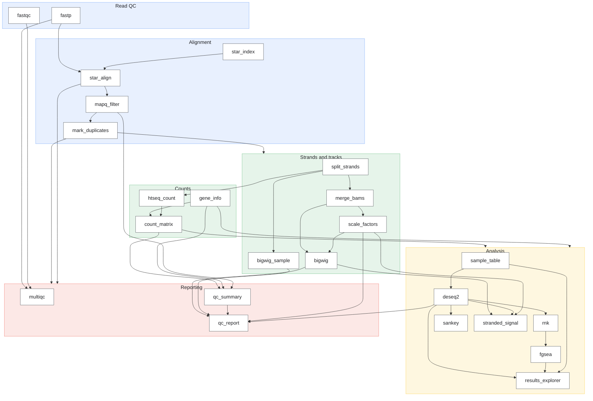
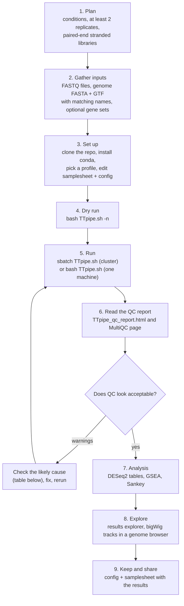

# TTpipe: TT-seq (TTchem-seq) Processing and Analysis Pipeline

## At a glance

**What it does.** Turns paired-end TT-seq sequencing files (FASTQ) into
alignments, strand-specific genome-browser tracks, per-gene counts,
differential expression, gene-set enrichment and a quality-control (QC)
report, using one command and two text files (a samplesheet and a config).

**Who it is for.** Bench and computational biologists who have TT-seq or
TTchem-seq data, at any institution. You do not need to know Snakemake (the
workflow engine that runs the steps), SLURM (a common cluster job scheduler)
or conda (a software installer) beforehand; the documentation explains each
when it first matters. Mouse and human are set up in the config; other
organisms are covered in [Other genomes](#other-genomes).

**What you need.**

- A Linux computer: either a SLURM cluster or a single machine with roughly
  30 GB of free memory (for a mouse genome; see [Cluster
  reference](docs/cluster.qmd)). macOS is not supported (see
  [Prerequisites](#prerequisites)).
- About 0.5 GB for a one-time [Miniforge](https://github.com/conda-forge/miniforge)
  (conda) install, plus disk space for the conda environments, the STAR
  genome index and your outputs. No other software is installed by hand;
  Snakemake downloads the rest on first use, so the machine that builds the
  environments needs internet access.
- Your FASTQ files, a genome FASTA and a matching GTF annotation, and the
  samplesheet (one row per sample).

**What you get.** Under one output folder: filtered BAMs, bigWig tracks, gene
counts, DESeq2 tables, GSEA tables, a Sankey diagram, an interactive results
page, and `qc/TTpipe_qc_report.html` with a traffic light per sample. The
list is detailed below in [What this pipeline does](#what-this-pipeline-does).

**Stuck?** See [Troubleshooting](#troubleshooting) and the longer
[troubleshooting chapter](docs/troubleshooting.qmd).

## What this pipeline does

A cell's RNA is a mixture of old and new molecules. Ordinary RNA-seq
measures the whole pool, which is dominated by RNA made hours or days ago.
**TT-seq** (transient transcriptome sequencing; **TTchem-seq** is a close
relative) measures only the *newly made* RNA. Cells are fed a uridine
analogue, **4-thiouridine (4sU)**, for a short pulse; RNA made during the
pulse carries 4sU, is tagged with biotin and pulled out, and only that
fraction is sequenced. The result is a read-out of transcription itself
rather than of RNA abundance, so it can show changes within hours of a
treatment, before the steady-state RNA pool has had time to move.

TTpipe turns the raw sequencing output (FASTQ files) into the files you
analyse and tells you whether the libraries look sane:

- **Alignments**: coordinate-sorted, MAPQ-filtered, deduplicated BAMs, plus
  per-strand BAMs.
- **bigWig tracks** for a genome browser, per condition (replicates merged)
  and per strand, scaled to a common library size (or, optionally, by a
  spike-in).
- **Per-gene counts** over the whole gene body (introns included, which is
  the key difference from an RNA-seq count), per strand, plus the matrix
  used for DESeq2.
- **Differential expression** (DESeq2) for every condition against a
  reference, **gene-set enrichment** (fgsea) and a **Sankey diagram** of
  how genes move between up, down and unchanged across comparisons.
- **A QC report**: one self-contained HTML page with pass / warn / fail
  traffic lights per sample, and (optionally) a standard MultiQC page.
- **A stranded signal page**: per-locus strand-separated tracks, sense /
  antisense metagene profiles and an antisense-fraction table, in one HTML file.
- **Optional spike-in normalization** (experimental, off by default): align to
  a combined host + spike-in reference (for example ERCC92), count the
  spike-in reads per sample, and scale the tracks and/or the DESeq2 size
  factors by the spike-in instead of library size. See
  [Spike-in normalization](#spike-in-normalization-optional-experimental).

It is run with Snakemake 8, on a SLURM cluster or on one machine, and is
driven by a samplesheet and a config file, following the layout of the
PhanstielLab [dietJuicer](https://github.com/PhanstielLab/dietJuicer)
pipeline (and the author's [MicroCPipe](https://github.com/jpflores-13/MicroCPipe)).

A rule-by-rule description of the code is in
[`CODE_GUIDE.md`](CODE_GUIDE.md); the full documentation book is in
[`docs/`](docs/) (rendered with Quarto, published at
<https://jpflores-13.github.io/TTpipe>).

### Where this comes from

TTpipe is a **reimplementation** of the TT-seq workflow described in a
pipeline guide for Magnitov et al. 2024, *Mol Cell*
([doi 10.1016/j.molcel.2024.11.031](https://doi.org/10.1016/j.molcel.2024.11.031);
data GEO [GSE260914](https://www.ncbi.nlm.nih.gov/geo/query/acc.cgi?acc=GSE260914);
the authors' code is at <https://github.com/magnitov/zfp143>). It is
**not the authors' code.** The tools and parameters follow the guide; the
places where TTpipe deliberately does something different are listed in
the table in [`CODE_GUIDE.md`](CODE_GUIDE.md#deliberate-changes-from-the-source-workflow).
The scale factors the guide quotes come from the authors' repository.

The test runs on real data (mouse GSE260914 and human GSE218726) are
recorded in [`docs/validation.qmd`](docs/validation.qmd).

### How the pieces fit together

```
  samplesheet.txt                                config/TTpipeConfig.yaml
  (one row per sample: Name, Condition,          (reference, strandedness, tracks,
   Replicate, Read1, Read2, directory)            counts, DESeq2, GSEA, QC thresholds)
          │                                                │
          └──────────────────────┬─────────────────────────┘
                                 ▼
                    workflows/TTpipe.snakefile
                                 │
   run_processing:   FastQC [-> fastp] -> STAR -> MAPQ filter -> Picard dedup
                                 │
                     split into forward / reverse strand BAMs
                       │                          │
       merge replicates per condition       HTSeq-count per sample and strand
       -> scale factors -> bigWigs                │
                                          counts_forward / counts_reverse
                                          -> counts_deseq2.txt   (sum or sense)
                                 │
   run_analysis:     DESeq2 (every comparison) -> rank list -> fgsea
                                 │                  └─> Sankey, PCA
   qc_report:        qc_summary -> TTpipe_qc_report.html     [multiqc -> TTpipe_multiqc.html]
                                 ▼
                    <outputDir>/…
```

The same workflow as a rule graph (every optional branch switched on; each
box is a rule, each arrow a dependency; an arrow that ends on a coloured stage box
means the rule feeds several rules of that stage). It is generated from the real
Snakefile by `python scripts/make_dag.py`; re-run that after changing a
rule. The same script also writes a static, stage-grouped SVG
([`docs/img/dag_full.svg`](docs/img/dag_full.svg)) when Graphviz is installed, and a test
fails if the diagrams go stale.

<!-- dag:start -->

<!-- dag:end -->

A **sample** is one samplesheet row (one pair of FASTQ files); a
**condition** is a group of samples that are replicates of each other (for
example `DMSO`, `2H`, `6H`, `24H`). Samples are processed one by one; the
replicates of a condition are merged only for the bigWig tracks, and
DESeq2 uses every sample separately.

---

## Your path through TTpipe

From planning to sharing results (details and a "when QC warns" table: [https://jpflores-13.github.io/TTpipe/journey.html](https://jpflores-13.github.io/TTpipe/journey.html)).



## Prerequisites

- A Linux machine or a SLURM cluster (see [Compute sites](#compute-sites)).
  A mouse STAR alignment needs roughly 30 GB of memory (see
  [Cluster reference](docs/cluster.qmd)); a typical laptop is not enough.
- `python3` >= 3.11 and `conda` >= 24.7.1, made available by your site's
  `profiles/<site>/env.sh` (a one-time Miniforge install in
  `$HOME/miniforge3` works everywhere).
- Paired-end TT-seq FASTQ files (`.fastq.gz`).
- A **reference** for your organism (mouse by default; see [Other
  genomes](#other-genomes)): a genome FASTA and a GTF annotation from
  the **same source**, so that chromosome names match (see
  [The reference](#the-reference) below). A STAR index is built once, or
  you can point at an existing one.
- Optional, for GSEA: gene-set `.gmt` files with gene **symbols** (for
  example MSigDB collections for your organism), which you download yourself.

Everything else (FastQC, fastp, STAR, samtools, Picard, deepTools, HTSeq,
R with DESeq2 / fgsea / ggforce, MultiQC) is installed by Snakemake into
per-rule conda environments from `envs/` on first use.

### The reference

The default configuration is mouse **mm10 / GRCm38** with the **GENCODE
vM25** annotation. The FASTA and the GTF must use the same chromosome names.
This is the most common way to silently ruin a TT-seq run: an Ensembl FASTA
names chromosomes `1`, `2`, `X`, a GENCODE GTF names them `chr1`, `chr2`,
`chrX`, and a pipeline that mixes the two finds no genes. Two matching
choices:

- GENCODE GRCm38 primary assembly (names `chr1`...) with the vM25 GTF:

    ```bash
    wget https://ftp.ebi.ac.uk/pub/databases/gencode/Gencode_mouse/release_M25/GRCm38.primary_assembly.genome.fa.gz
    wget https://ftp.ebi.ac.uk/pub/databases/gencode/Gencode_mouse/release_M25/gencode.vM25.annotation.gtf.gz
    gunzip GRCm38.primary_assembly.genome.fa.gz gencode.vM25.annotation.gtf.gz
    ```

- UCSC mm10 (names `chr1`...), whose per-chromosome files are at
  <https://hgdownload.soe.ucsc.edu/goldenPath/mm10/chromosomes/>, with the
  same GENCODE vM25 GTF. You must concatenate the chromosome files you want
  into one FASTA.

TTpipe stops at startup only if one file uses `chr`-prefixed names and the other does not (it compares the first sequence); it cannot catch other mismatches, so look at the first lines of both
files (`grep '>' genome.fa | head`, `head genes.gtf`) before you start.

## Other genomes

TTpipe contains no mouse-specific code. A search of the workflows and scripts
finds mouse only in default file paths, comments and the `genome:` label, which
is a free-text name shown in reports. Choosing another organism is a matter of
config keys.

Both mouse (mm10, GENCODE vM25) and human (GRCh38 primary assembly,
GENCODE v44) have been run; see [Validation](docs/validation.qmd).

**Human.** Set these keys in `config/TTpipeConfig.yaml`:

```yaml
genome: 'hg38'                     # label only
genome_fasta: '/path/to/GRCh38.primary_assembly.genome.fa'    # GENCODE human, primary assembly
gtf: '/path/to/gencode.v<release>.annotation.gtf'             # GENCODE human GTF, same release family
star_index: '/path/to/human_STARgenome'
build_star_index: true             # first run only
sjdb_overhang: 100                 # your read length - 1
gsea_collections:
  Hallmarks: '/path/to/h.all.v<release>.Hs.symbols.gmt'      # human MSigDB, gene symbols
```

Use the GENCODE human primary-assembly FASTA and the GTF from the same
GENCODE source, so that both name chromosomes `chr1`, `chr2`, ... (the check
described in [The reference](#the-reference) applies unchanged). Set
`sjdb_overhang` to your read length minus 1. For GSEA use the human MSigDB
collections whose file names end in `.Hs.symbols.gmt`: TTpipe ranks genes by
the `gene_name` in the GTF, so the gene sets must use the same symbols.

**Any other organism.** You need a genome that STAR can index and a GTF in which:

- every gene has a line with feature type `gene` and a `gene_id` attribute
  (`htseq_feature` and `htseq_id_attribute` can name another feature or
  attribute, but counting exons instead of genes changes the science: most
  TT-seq signal is in introns, see [From Reads to
  Results](docs/journey.qmd));
- ideally, a `gene_name` attribute; if it is missing, `gene_name` falls back
  to `gene_id` (GSEA then needs gene sets keyed by that id);
- for the rRNA QC metric, GENCODE-style `gene_type` values `rRNA` and
  `Mt_rRNA`, or Ensembl-style `gene_biotype` with the same values. With no
  type at all the rRNA column is blank; with other names for ribosomal genes
  they are not recognised and the metric reads near zero. Nothing else is
  affected.

STAR memory depends on the genome. Measured: mouse about 26 GB for alignment
and about 29 GB for the index build; human GRCh38 + ERCC92 about 29 GB for
alignment and **62.5 GB** for the index build (34 minutes on 16 threads).
The `pioneer` profile gives `star_index` 72 GB for that reason; check your own
runs with `seff` or `sacct` and raise `star_align` and `star_index` `mem_mb`
in your profile (see [Cluster reference](docs/cluster.qmd#tuning-resources)).
The full walk-through is in [Setup](docs/setup.qmd#other-genomes).

## Quick start

The two routes differ only in steps 4 and 5. Both assume Linux. "Your
account" and "your partition" mean values specific to your cluster; the steps
show how to look them up.

**Both routes**

1. Install Miniforge once (skip if you have conda 24.7.1 or newer in a
   place you can write to) and clone TTpipe:

    ```bash
    wget https://github.com/conda-forge/miniforge/releases/latest/download/Miniforge3-Linux-x86_64.sh
    bash Miniforge3-Linux-x86_64.sh -b -p $HOME/miniforge3
    git clone https://github.com/jpflores-13/TTpipe.git
    cd TTpipe
    ```

2. Download a matching genome FASTA and GTF ([The reference](#the-reference)
   or [Other genomes](#other-genomes)) and unzip them.

3. Edit the tab-separated `samplesheet.txt`, one row per sample (one pair of
   FASTQ files), and the lines of `config/TTpipeConfig.yaml` that name your
   files:

    | Name | Condition | Replicate | Read1 | Read2 | Sequencing_Directory |
    |------|-----------|-----------|-------|-------|----------------------|
    | ZFP143_DMSO_rep1 | DMSO | rep1 | ZFP143_DMSO_rep1_R1.fastq.gz | ZFP143_DMSO_rep1_R2.fastq.gz | /path/to/fastq/ |

    ```yaml
    samplesheet: 'samplesheet.txt'
    genome_fasta: '/path/to/genome.fa'
    gtf: '/path/to/annotation.gtf'
    star_index: '/path/to/STARgenome'
    build_star_index: true          # first run only; then set to false
    strandedness: 'dUTP'            # or 'forward': check with your library prep
    reference_condition: 'DMSO'     # the control Condition in your samplesheet
    ```

   `Name`, `Condition` and `Replicate` are always required; `Read1`,
   `Read2` and `Sequencing_Directory` only when `run_processing` is true.
   Values may contain only letters, digits, `.`, `_` and `-`. The shipped
   samplesheet lists the eight samples of the mouse example in the
   [vignette](docs/vignette.qmd) with placeholder paths; replace them.

**(a) On a SLURM cluster**

4. Make a profile for your cluster (a folder with your partition, account
   and memory settings). Look up the values with `sinfo -s` (partitions)
   and `sacctmgr show assoc user=$USER` (accounts):

    ```bash
    cp -r profiles/slurm-template profiles/mycluster
    nano profiles/mycluster/config.yaml   # slurm_account, slurm_partition
    nano profiles/mycluster/env.sh        # only if you do not use $HOME/miniforge3
    echo 'export TTPIPE_PROFILE=profiles/mycluster' >> ~/.bashrc
    echo 'export TTPIPE_OUTPUT_ROOT=/path/with/space/ttpipe' >> ~/.bashrc
    source ~/.bashrc
    ```

   If your home directory has a small quota, also set `CONDA_PKGS_DIRS`,
   `XDG_CACHE_HOME` and `TMPDIR` to a larger location first
   ([Troubleshooting](docs/troubleshooting.qmd)).
5. Dry run, build the conda environments on a node with internet access,
   then submit:

    ```bash
    bash   TTpipe.sh -n                          # lists every job; runs nothing
    bash   TTpipe.sh --conda-create-envs-only    # downloads the software once
    sbatch TTpipe.sh                             # the whole workflow
    ```

**(b) On a single machine**

4. The default profile is `profiles/local`; nothing to set up. It limits
   total memory to 64 GB (`mem_mb=64000` in `profiles/local/config.yaml`);
   lower or raise that to your machine. STAR needs roughly 26 to 30 GB for a
   mouse genome, so the machine needs at least that much free memory.
5. Dry run, then run:

    ```bash
    bash TTpipe.sh -n
    bash TTpipe.sh
    ```

**Both routes, last step**

6. Open `output/qc/TTpipe_qc_report.html` in a browser, and take the tracks,
   counts and DESeq2 tables from `output/`. If a run stops, see [After a
   failed run](#after-a-failed-run).

### Trying it on a small example

The folder `tests/dryrun/` holds **placeholder files only**: one made-up read,
an 80-base fake chromosome, a fake STAR index. They exist so that a Snakemake
dry run (`bash TTpipe.sh -n` style, as the test suite does) can build the job
graph. No tool is run on them and they are not real data; a full run on them
will not work. For a first real run, use the public mouse embryonic stem cell
data of GEO series
[GSE260914](https://www.ncbi.nlm.nih.gov/geo/query/acc.cgi?acc=GSE260914)
(the [vignette](docs/vignette.qmd) shows how to find the runs). To keep the
first run small and quick, take only the first N read pairs of each file,
for example (keeping the same pairs in both mates):

```bash
zcat sample_R1.fastq.gz | head -n 12000000 | gzip > sub_R1.fastq.gz   # 3 million pairs
zcat sample_R2.fastq.gz | head -n 12000000 | gzip > sub_R2.fastq.gz
```

(a FASTQ record is 4 lines, so `head -n` of 4 x N lines keeps N read pairs.)
Subsampling this way is a general technique; it keeps the pairs matched, but
a subsample is only for checking that the pipeline works, not for results.

### Dry run first

```bash
bash TTpipe.sh -n
```

Prints every job and shell command that would be submitted; nothing runs.
Any extra arguments are passed straight to `snakemake`.

### Switches

Three keys choose what runs (at least one must be true):

| Key | Default | Runs |
|-----|---------|------|
| `run_processing` | `true` | FASTQ to BAM, tracks and counts |
| `run_analysis` | `true` | DESeq2, GSEA, Sankey |
| `qc_report` | `true` | QC table and HTML report |

`results_explorer` (default `true`) adds the interactive results page; it
needs `run_analysis` (see [The results explorer](#the-results-explorer)).
`stranded_plots` (default `true`) adds the stranded signal page when the
bigWigs are made in the run or already exist (see
[Stranded signal plots](#stranded-signal-plots)).

`run_processing: false` with `analysis_counts: '/path/to/counts.txt'` runs
the analysis on a count matrix you already have. `multiqc: true` (default)
also builds a MultiQC page on processing runs. See
[Recipes](docs/recipes.qmd).

### Email notifications

Set an address and the workflow emails you once when it starts, once when it
finishes, and once if any job fails (not once per job):

```bash
export TTPIPE_EMAIL=you@university.edu   # e.g. in ~/.bashrc
```

The address can also go in `notify: email:` in the config; the environment
variable keeps it out of a shared repo and wins if both are set. With
neither set, nothing is sent. `notify: events:` picks which of `start`,
`success`, `error` to send, and `notify: command:` is the shell command that
sends one message (default `mail -s {subject} {email}`, body on stdin; use
e.g. `sendmail {email}` on clusters without `mail`, putting a `Subject:`
line in the body). The failure email includes the last 40 lines of the
Snakemake log. Dry runs send nothing, and a failed email never fails the
workflow. Check that your cluster can send mail with
`echo test | mail -s test $TTPIPE_EMAIL`.

The launcher job itself also carries `#SBATCH --mail-type=END,FAIL,TIME_LIMIT_80`;
`sbatch --mail-user=$TTPIPE_EMAIL TTpipe.sh` directs SLURM's own mail.

### After a failed run

```bash
bash unlock.sh               # release the Snakemake lock
sbatch TTpipe.sh             # --rerun-incomplete is on by default
```

Finished steps are kept; only the failed and missing ones are redone.

### What runs

| Rule | Jobs | What it does |
|------|------|--------------|
| `fastqc` | 1 per sample and mate | FastQC on the raw reads |
| `fastp` | 1 per sample (`trim: true`) | Adapter and quality trimming; off by default |
| `star_index` | 1 (`build_star_index: true`) | `STAR --runMode genomeGenerate` |
| `star_align` | 1 per sample | STAR with `--quantMode GeneCounts`, sorted BAM |
| `mapq_filter` | 1 per sample | `samtools view -q <min_mapq>` |
| `mark_duplicates` | 1 per sample | Picard MarkDuplicates (duplicates removed), index |
| `split_strands` | 1 per sample and strand | Forward / reverse strand BAMs by read flags |
| `merge_bams` | 1 per condition and strand set | Replicates merged for tracks |
| `scale_factors` | 1 | One scale factor per condition |
| `bigwig` | 1 per condition and strand set | `bamCoverage --scaleFactor` |
| `bigwig_sample` | 1 per sample and strand set (`sample_tracks: true`) | Per-sample tracks |
| `gene_info` | 1 | Gene table from the GTF |
| `htseq_count` | 1 per sample and strand | `htseq-count --type gene` |
| `count_matrix` | 1 | Gene by sample matrices, DESeq2 matrix |
| `sample_table` | 1 | Sample metadata for DESeq2 |
| `deseq2` | 1 | All comparisons, normalised and VST counts, PCA |
| `rnk` | 1 per comparison | Ranked gene list for GSEA |
| `fgsea` | 1 per collection and comparison | Preranked GSEA |
| `sankey` | 1 | Up / down / unchanged categories across comparisons |
| `results_explorer` | 1 (`results_explorer: true`) | One interactive HTML page of the DESeq2 and GSEA results |
| `stranded_signal` | 1 (`stranded_plots: true`) | One interactive HTML page: stranded locus tracks, metagene profiles, antisense-fraction table |
| `qc_summary` | 1 | Per-sample QC table |
| `qc_report` | 1 | The static HTML report |
| `multiqc` | 1 (`multiqc: true`) | Standard MultiQC page |

With `spike_in.enabled: true` (off by default) these rules are added or
replaced; see [Spike-in normalization](#spike-in-normalization-optional-experimental):

| Rule | Jobs | What it does |
|------|------|--------------|
| `spike_reference` | 1 | Combined host + spike-in FASTA and GTF (spike-in names prefixed, `gene` lines added to exon-only GTFs) |
| `spike_idxstats` | 1 per sample | `samtools idxstats` of the final BAM |
| `spike_summary` | 1 | Host and spike-in read pairs per sample (and per spike-in contig) |
| `scale_factors` | 1 | Replaced: from spike-in pairs (`'tracks'` in `normalize`) or from host pairs only |
| `bigwig_sample` | as above | Replaced: same basis as `scale_factors`, per sample |
| `count_matrix` | 1 | Replaced: host genes in the usual matrices, spike-in genes in `counts/counts_spike.txt` |
| `spike_size_factors` | 1 (`'deseq2'` in `normalize`, analysis on) | DESeq2 size factors (`total`) or control genes (`genes`) |
| `deseq2` | 1 | Replaced: same as above, with the spike-in size factors |

---

## Compute sites

Everything specific to a compute site lives in one folder under `profiles/`.
The config and samplesheet are the same on every cluster; what differs is
set once per cluster, outside git:

| Setting | How | Example |
|---------|-----|---------|
| Compute profile | `export TTPIPE_PROFILE=...` in `~/.bashrc` | `profiles/biowulf` |
| Where output goes | `export TTPIPE_OUTPUT_ROOT=...` in `~/.bashrc` (unset: the folder you launch from) | `/data/$USER/ttpipe` |
| Conda location | `export TTPIPE_CONDA_ROOT=...` if Miniforge is not in `$HOME/miniforge3` | `/data/$USER/miniforge3` |

The profile is chosen by, in order: `--profile` on the command line,
`$TTPIPE_PROFILE`, then `hpcProfile` in the config (default
`profiles/local`). A relative `outputDir` goes under `$TTPIPE_OUTPUT_ROOT`
when it is set; an absolute one is used as written.

| Folder | For |
|--------|-----|
| `profiles/slurm-template/` | **Start here on any SLURM cluster**: copy it and fill in the `<...>` values |
| `profiles/local/` | One machine with no scheduler |
| `profiles/biowulf/`, `profiles/longleaf/`, `profiles/pioneer/` | **Examples only**: the same template filled in for three real SLURM sites (NIH Biowulf, UNC Longleaf, Case Western Pioneer), using the partition names the author used there. Useful as a model; your own site needs its own profile |

Each folder has two files: `env.sh` (sourced by the launchers; makes
`python3` and `conda` available) and `config.yaml` (the Snakemake profile:
scheduler, account, partition, and each rule's threads / memory / time).
The per-rule numbers are starting guesses; check each job's memory after a
first run (`seff <jobid>` or `sacct`) and adjust.

To set up a new SLURM cluster:

```bash
cp -r profiles/slurm-template profiles/<cluster>
nano profiles/<cluster>/config.yaml   # account, partition
nano profiles/<cluster>/env.sh        # module loads or Miniforge path
echo 'export TTPIPE_PROFILE=profiles/<cluster>' >> ~/.bashrc
source ~/.bashrc
sbatch TTpipe.sh
```

`sinfo -s` lists partitions, `sacctmgr show assoc user=$USER` lists your
accounts. The `longleaf` and `pioneer` profiles contain a required
placeholder, `<your-slurm-account>`, which SLURM rejects until you replace it
with your own account (or delete the line if your cluster has no accounts).
[Cluster reference](docs/cluster.qmd) has a step-by-step guide for your own
cluster and for a single workstation.

---

## Output structure

Everything is written under `outputDir` (default `output/`):

```
output/
├── qc/
│   ├── TTpipe_qc_report.html           # the QC report (open in a browser)
│   ├── sample_qc.tsv                   # the per-sample numbers behind it
│   ├── TTpipe_multiqc.html             # MultiQC page (multiqc: true, processing runs)
│   └── fastqc/{sample}_R{1,2}_fastqc.{zip,html}
├── {sample}/
│   ├── {sample}.bam (.bai)             # MAPQ-filtered, deduplicated
│   ├── {sample}_forward.bam (.bai)     # reads from RNA transcribed from the + strand
│   ├── {sample}_reverse.bam (.bai)     # reads from RNA transcribed from the - strand
│   ├── stats/                          # STAR log, ReadsPerGene, Picard metrics, pair counts (+ idxstats with spike-in)
│   ├── counts/{sample}_{strand}.counts.txt   # HTSeq output
│   ├── logs/   benchmarks/             # one log and benchmark per job
├── merged/{condition}[_forward|_reverse].bam   # replicates merged (for tracks)
├── tracks/
│   ├── scale_factors.tsv
│   ├── {condition}[_forward|_reverse].bw
│   └── samples/{sample}[_forward|_reverse].bw  # only if sample_tracks: true
├── counts/
│   ├── gene_info.tsv                   # gene_id, gene_name, gene_type, chr, start, end, strand, length
│   ├── counts_forward.txt  counts_reverse.txt
│   ├── counts_deseq2.txt               # the matrix DESeq2 reads (count_strand)
│   ├── counts_spike.txt                # spike-in genes x samples (spike-in on, with spike_in.gtf)
│   └── samples_deseq2.txt              # sample, condition, replicate
├── spike/                              # only with spike_in.enabled: true
│   ├── spike_counts.tsv                # sample, condition, host_pairs, spike_pairs_all, spike_pairs_used, spike_pct
│   ├── spike_contig_counts.tsv         # read pairs per spike-in contig and sample
│   └── size_factors.tsv | control_genes.txt   # for DESeq2 ('deseq2' in normalize)
├── analysis/
│   ├── deseq2/    degs_{treatment}_vs_{reference}.csv, deg_summary.tsv,
│   │              normalized_counts.tsv, vst.tsv, sankey_categories.tsv
│   │              (+ deseq2_size_factors.tsv with spike-in size factors)
│   ├── gsea/      {comparison}.rnk, {collection}_{comparison}.tsv
│   ├── TTpipe_results_explorer.html    # interactive results page (open in a browser)
│   ├── TTpipe_stranded_signal.html     # stranded tracks, metagene, antisense table (open in a browser)
│   ├── stranded_signal/                # static figures, only if track_static_formats is set
│   └── figures/   pca.pdf, sankey.pdf
├── reference/star_index/               # only if build_star_index is true and star_index is empty
├── reference/host_spike.gtf, spike_contigs.tsv, spike_genes.tsv   # spike-in on (host_spike.fa is temporary)
├── logs/   benchmarks/                 # logs for the jobs that are not per sample
└── logs_slurm/                         # SLURM job logs (cluster profiles)
```

The STAR BAM, the MAPQ-filtered BAM and trimmed FASTQs are temporary and
deleted once the steps that need them have finished. The merged BAMs are
kept.

---

## The QC report

`output/qc/TTpipe_qc_report.html` is written by `scripts/qc_report.py`. It
is a single static file (no server, nothing to install; the plotting
library is inlined) that you can open locally or email to a collaborator.
It shows, per sample (one colour per condition):

- a **summary table** (sortable) with traffic lights for input read pairs,
  unique %, multi-mapped %, too-short %, duplicate %, reads on the gene
  strand %, rRNA % and replicate correlation, and an overall status per
  sample (its worst metric);
- **alignment** and read-pair retention, **duplication**, **strandedness**
  (this is the check on your `strandedness` setting), **rRNA content**;
- a **sample correlation** heatmap, a **PCA**, the number of **DEGs** per
  comparison, and the **scale factors** and track list;
- a box listing every section that was **skipped** and why, and a box of
  what is **not assessed** (labeled-versus-total enrichment, synthesis and
  degradation rates; the spike-in fraction is not shown in the report yet,
  it is in `spike/spike_counts.tsv` when the spike-in module is on);
- **Methods**: every metric's definition and the active thresholds.

Thresholds come from `qc_thresholds` in the config. The `warn` values are
the guide's rules of thumb; the `fail` values are TTpipe defaults, not
published standards. `docs/qc.qmd` explains how to read each panel.

---

## The results explorer

`output/analysis/TTpipe_results_explorer.html` is written by
`scripts/results_explorer.py` when `results_explorer: true` (the default; it
needs `run_analysis`, and works in analysis-only mode too). It is one static
file: the data are embedded as JSON and the plotting library is inlined, so
you open it by double-clicking it (or `file://` in a browser) with no server
and no network, and you can email it. It has:

- a contrast menu and a volcano / MA toggle; points are Up / Down / n.s.
  (Sankey colours), with live Up and Down counts;
- two cut-offs (padj and |log2FC|) that start at `alpha` and
  `lfc_threshold` from the config and can be changed on the page;
- a gene biotype filter (`gene_type` from the GTF; protein_coding and
  lncRNA first, the rest grouped) and "colour by biotype";
- gene search (symbol or gene_id, prefix match), labels for the top N
  genes, and hover text with name, biotype, baseMean, log2FC and padj;
- click a point (or a table row) for the per-sample normalized counts of
  that gene, coloured by condition;
- a sortable, filterable results table with a "download CSV" button for
  the rows currently matching the filters;
- a GSEA tab (pathway, size, NES, pval, padj, leadingEdge) when fgsea
  results exist; with no GSEA results there is no tab.

Genes with NA padj are shown as n.s. Only the cut-offs on the page change
when you move a slider: `deg_summary.tsv`, the Sankey and the GSEA files
always use the config values. Biotype filtering uses the annotation's
`gene_type` (GENCODE), so "lncRNA" is whatever the annotation calls lncRNA;
nothing is detected de novo. This version has no genome browser or track
panel and does no eRNA calling; tracks and custom feature sets are future
work. The page has been built from real pipeline output on the cluster
(mouse test: 13,419 genes, three contrasts) and its controls checked in
headless Chrome; see [Validation](docs/validation.qmd). A file with many contrasts or large GSEA collections can reach tens
of MB; the job log prints the size and warns above 40 MB.

---

## Stranded signal plots

`output/analysis/TTpipe_stranded_signal.html` is written by
`scripts/stranded_signal.py` when `stranded_plots: true` (the default). It is
one static file like the explorer (data embedded, plotting library inlined,
works from `file://`). It draws the stranded bigWigs of every condition:

- **Locus tracks**: one panel per condition, the RNA made from the + strand
  above the axis and the RNA made from the - strand mirrored below it (both
  bigWigs hold positive numbers), a shared x axis, one y scale shared by all
  conditions (a "free y" box scales each panel on its own) and gene models
  underneath. A dropdown and a search box choose the locus.
- **Metagene**: sense and antisense signal relative to gene orientation, TSS-centred
  and gene-body-scaled, per `gene_type` group (default protein_coding and
  lncRNA, expressed genes only), mean or median. The `lncRNA` group also
  takes the older GENCODE types (`lincRNA`, `antisense`,
  `processed_transcript`, ...) that annotations such as mouse vM25 still use;
  the group's label lists the types it included.
- **Strand table**: antisense fraction per gene and condition from the strand-split
  counts, sortable, filterable, with a CSV download.

Loci come from `track_loci` (symbols, gene_ids, `chr:start-end`), the top
`track_top_degs` genes of each DESeq2 contrast, and an optional BED
(`track_regions_bed`); entries that cannot be found are listed on the page and
in the log, never silently dropped. Values are the bigWig values as written:
scaled by the factors in `tracks/scale_factors.tsv` (library size, or the
spike-in when `spike_in.normalize` includes `'tracks'`). To plot other genes, add them to
`track_loci` and run again: only this rule is redone.

```yaml
track_loci: ['Gapdh', 'ENSMUSG00000057666', 'chr1:3000000-3010000']
track_top_degs: 10             # 0 = off
track_regions_bed: ''          # optional BED of enhancers, lncRNAs, ...
track_flank: 5000
track_bin_size: 100
metagene_groups: ['protein_coding', 'lncRNA']
metagene_bed: ''               # optional BED to profile, centre-aligned
track_static_formats: []       # ['svg', 'pdf', 'png'] for publication-style figures
```

The page is skipped (not an error) in analysis-only runs that have no
bigWigs. TTpipe does not call enhancer RNAs; a BED file only says where to
look. The page has run as a cluster job on real data: the 8-sample mouse
test (13,419 expressed genes; Gapdh and Zfp143 reads about 97-99 % on their
own strand) and the 10-sample human spike-in test (GAPDH and ACTB on their
own strand); see [Analysis](docs/analysis.qmd#stranded-signal) and
[Validation](docs/validation.qmd).

---

## Spike-in normalization (optional, experimental)

Library-size scaling assumes the total amount of new RNA is the same in every
sample. When a treatment changes transcription globally, that assumption hides
the change. A **spike-in** (RNA or cells added in a fixed amount to every
sample, for example ERCC92 synthetic RNAs) gives an external reference
instead. The module is **off by default**; with `enabled: false` the workflow
is exactly the one without it.

```yaml
spike_in:
  enabled: true
  fasta: '/path/to/ERCC92.fa'          # spike-in sequences
  gtf: '/path/to/ERCC92.gtf'           # optional; exon-only is fine
  prefix: 'spike_'                     # added to spike-in contig and gene names
  use_contigs: []                      # which spike-in contigs set the factors; [] = all
  normalize: ['tracks', 'deseq2']      # what the spike-in scales; [] = only count
  size_factor_method: 'total'          # or 'genes' (DESeq2 on the spike-in genes; needs gtf)
```

What happens when it is on:

1. One combined host + spike-in reference is written (`reference/host_spike.*`),
   with every spike-in name prefixed so host and spike-in reads can never be
   confused. **The STAR index must be built from it**: set
   `build_star_index: true` with a *new* `star_index` folder, or point
   `star_index` at an index already built from the combined reference. A run
   with an old index that lacks the spike-in contigs stops before any job with
   a message saying so.
2. Each final BAM's reads are counted per contig: `spike/spike_counts.tsv`
   (host and spike-in read pairs, spike-in %) and `spike/spike_contig_counts.tsv`.
3. `'tracks'`: the bigWig factor of each condition is
   (largest spike-in pair count) / (this condition's). Without `'tracks'` the
   usual library-size factor is used, but on host reads only.
4. `'deseq2'` (with the analysis on): DESeq2 size factors come from the
   spike-in (`total`: spike-in pairs / their geometric mean; `genes`: DESeq2's
   median-of-ratios on the spike-in genes). They are set before `vst()`, so
   the VST, PCA and normalized counts use them too, and are written to
   `analysis/deseq2/deseq2_size_factors.tsv`.
5. The usual count matrices hold host genes only; spike-in genes go to
   `counts/counts_spike.txt`.

**For TT-seq, choose `use_contigs` carefully.** TT-seq protocols often add a
few spike-ins that carry 4sU and a few that do not. Only the labeled ones go
through the 4sU purification like the nascent RNA, so `use_contigs` should
list those (names as in the FASTA, without the prefix). Check
`spike/spike_contig_counts.tsv` to see which spike-ins have reads at all.

**Status.** The processing side has run on real human data (GSE218726, 10
samples, 2 M read pairs each, GRCh38 + ERCC92): the combined reference, index,
counting and spike-in track factors all worked, and ERCC genes stayed out of
the host count matrices. With only 30 to 89 spike-in read pairs per sample in
that subset, the factors were a test of the mechanics, not a usable
normalization. DESeq2 with spike-in size factors, the `genes` method, and the
QC report's display of spike-in numbers are not done or not run on real data.
Details in [Validation](docs/validation.qmd) and
[Configuration](docs/configuration.qmd).

## Pipeline files

| File | Purpose |
|------|---------|
| `TTpipe.sh` | Launcher; run this |
| `unlock.sh` | Release the Snakemake lock after a failed run |
| `samplesheet.txt` | One row per sample (input) |
| `config/TTpipeConfig.yaml` | Everything a user normally edits |
| `config/requirements.txt` | Snakemake version for the launcher venv |
| `profiles/<site>/config.yaml` | Scheduler settings and per-rule resources for one site |
| `profiles/<site>/env.sh` | Software setup for that site |
| `workflows/TTpipe.snakefile` | Entry point: targets, notifications, `sample_table` |
| `workflows/rules/common.smk` | Samplesheet and config checks, output paths, targets |
| `workflows/rules/processing.smk` | FASTQ to BAM, tracks, counts |
| `workflows/rules/analysis.smk` | DESeq2, ranked lists, fgsea, Sankey |
| `workflows/rules/report.smk` | QC table and HTML report |
| `workflows/rules/explorer.smk` | Interactive results explorer |
| `workflows/rules/stranded.smk` | Stranded signal page |
| `workflows/rules/multiqc.smk` | Optional MultiQC page |
| `workflows/rules/spike.smk` | Optional spike-in rules (included only when `spike_in.enabled`) |
| `scripts/build_spike_reference.py`, `spike_summary.py`, `spike_size_factors.py` | Spike-in reference, counts and size factors |
| `scripts/gene_info.py`, `make_count_matrix.py`, `scale_factors.py` | Processing helpers |
| `scripts/run_deseq2.R`, `make_rnk.R`, `run_fgsea.R`, `make_sankey.R`, `tt_analysis_utils.R` | Analysis scripts |
| `scripts/qc_summary.py`, `qc_report.py` | QC table and report |
| `scripts/results_explorer.py` | Interactive results page |
| `scripts/stranded_signal.py` | Stranded signal page (tracks, metagene, antisense table) |
| `scripts/make_dag.py` | Regenerates the rule-graph diagrams |
| `envs/*.yml` | Conda environments used by the rules |
| `tests/` | pytest, placeholder fixtures for dry runs (used by CI) |
| `docs/` | The Quarto documentation book |

---

## Troubleshooting

| Symptom | Likely cause | Fix |
|---------|--------------|-----|
| `... is missing column(s): [...]` | Samplesheet header typo, or spaces instead of tabs | Headers must be tab-separated and include the required columns |
| `... values may only contain letters, digits ...` | A space or other character in `Name`, `Condition` or `Replicate` | Use letters, digits, `.`, `_`, `-` |
| `config 'star_index' is empty` | No index given and `build_star_index` false | Set `star_index`, or set `build_star_index: true` |
| `MissingInputException` for the STAR index `SA` file | `star_index` points at a folder with no index | Build it (`build_star_index: true`) or fix the path |
| `reference_condition ... is not a Condition` | Typo, or the condition is not in the samplesheet. It is checked even when `run_analysis: false` | Set it to one of your samplesheet conditions (spelling and case) |
| `Failed to evaluate resources value '<your-slurm-account>'` | The profile still has the placeholder account (a dry run does not catch this) | Put your account in `profiles/<site>/config.yaml` |
| `No module named '__future__'`, `Could not find platform independent libraries`, or `init_fs_encoding ... no codec search functions registered` | A conda env was built half-way (killed, or two builds at once) | Delete that `.snakemake/conda/<hash>_` folder and the package cache, rebuild once ([Troubleshooting](docs/troubleshooting.qmd)) |
| `spike_in: the STAR index ... does not contain the spike-in contigs` | Spike-in on, but the index was built from the host genome only | `build_star_index: true` with a new `star_index` folder |
| `zero spike-in read pairs` | No spike-in reads in a sample (not added, wrong FASTA, or `use_contigs`) | Check `spike/spike_contig_counts.tsv`; fix `fasta` / `use_contigs`, or `normalize: []` to only count |
| Counts are zero or tiny; few genes found | FASTA and GTF chromosome names differ (`1` vs `chr1`) | Use a FASTA and GTF from the same source ([The reference](#the-reference)) |
| QC report says most reads are on the wrong strand | `strandedness` is the other library type | Switch `dUTP` and `forward`, and rerun from `split_strands` ([Recipes](docs/recipes.qmd)) |
| `sample names differ between the count matrix and the sample table` | Analysis-only matrix columns do not match the samplesheet `Name`s | Rename the columns or the `Name`s |
| Snakemake lock error | Previous run crashed | `bash unlock.sh`, then resubmit |
| A job was killed for memory (`OUT_OF_MEMORY`) | The rule's `mem_mb` in the profile is a guess and too small | Raise it in `profiles/<site>/config.yaml` |
| Output appears in the folder you launched from | `TTPIPE_OUTPUT_ROOT` not set in the shell that ran `sbatch` | Add the export to `~/.bashrc`, `source ~/.bashrc`, resubmit |
| Jobs go to the wrong cluster's partitions | `TTPIPE_PROFILE` not set, so the config default was used | `echo $TTPIPE_PROFILE`; set it or pass `--profile` |
| No emails arrive | `mail` missing or blocked on the cluster | Test `echo test \| mail -s test $TTPIPE_EMAIL`; change `notify: command:` |
| A job failed | - | Per-sample logs are in `output/<sample>/logs/`, others in `output/logs/` |

More problems, each as symptom, cause and fix (disk quota errors while
building environments, MultiQC import errors, memory kills, internet access
for the first run, and others), are in the
[troubleshooting chapter](docs/troubleshooting.qmd).

For a description of every rule and script, see
[`CODE_GUIDE.md`](CODE_GUIDE.md).

---

## References

- Magnitov et al., *Mol Cell* (2024),
  [doi 10.1016/j.molcel.2024.11.031](https://doi.org/10.1016/j.molcel.2024.11.031):
  the study whose TT-seq workflow TTpipe reimplements; data GEO
  [GSE260914](https://www.ncbi.nlm.nih.gov/geo/query/acc.cgi?acc=GSE260914);
  authors' code <https://github.com/magnitov/zfp143>.
- dietJuicer, <https://github.com/PhanstielLab/dietJuicer>: the pipeline
  layout TTpipe follows.
- Schwalb et al., *Science* (2016): TT-seq. Gregersen et al., *Nature
  Protocols* (2020): TTchem-seq.
- Love, Huber, Anders, *Genome Biology* (2014): DESeq2. Korotkevich et al.,
  bioRxiv (2016): fgsea.
- Full list: `docs/references.qmd`.
