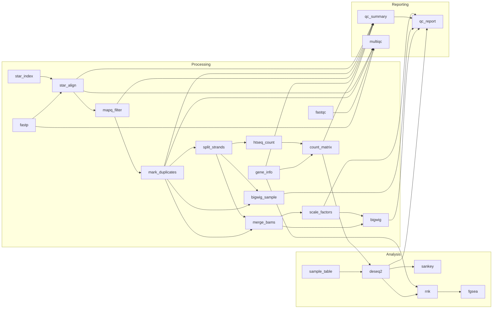

# TTpipe: TT-seq (TTchem-seq) Processing and Analysis Pipeline

## What this pipeline does

A cell's RNA is a mixture of old and new molecules. Ordinary RNA-seq
measures the whole pool, which is dominated by RNA made hours or days ago.
**TT-seq** (transient transcriptome sequencing; **TTchem-seq** is a close
relative) measures only the *newly made* RNA. Cells are fed a uridine
analogue, **4-thiouridine (4sU)**, for a short pulse; RNA made during the
pulse carries 4sU, is tagged with biotin and pulled out, and only that
fraction is sequenced. The result is a read-out of transcription itself
rather than of RNA abundance, so it can show changes within hours of a
treatment, before the steady-state RNA pool has had time to move.

TTpipe turns the raw sequencing output (FASTQ files) into the files you
analyse and tells you whether the libraries look sane:

- **Alignments**: coordinate-sorted, MAPQ-filtered, deduplicated BAMs, plus
  per-strand BAMs.
- **bigWig tracks** for a genome browser, per condition (replicates merged)
  and per strand, scaled to a common library size.
- **Per-gene counts** over the whole gene body (introns included, which is
  the key difference from an RNA-seq count), per strand, plus the matrix
  used for DESeq2.
- **Differential expression** (DESeq2) for every condition against a
  reference, **gene-set enrichment** (fgsea) and a **Sankey diagram** of
  how genes move between up, down and unchanged across comparisons.
- **A QC report**: one self-contained HTML page with pass / warn / fail
  traffic lights per sample, and (optionally) a standard MultiQC page.

It is run with Snakemake 8, on a SLURM cluster or on one machine, and is
driven by a samplesheet and a config file, following the layout of the
PhanstielLab [dietJuicer](https://github.com/PhanstielLab/dietJuicer)
pipeline (and the author's [MicroCPipe](https://github.com/jpflores-13/MicroCPipe)).

A rule-by-rule description of the code is in
[`CODE_GUIDE.md`](CODE_GUIDE.md); the full documentation book is in
[`docs/`](docs/) (rendered with Quarto, published at
<https://jpflores-13.github.io/TTpipe>).

### Where this comes from, and what is and is not tested

TTpipe is a **reimplementation** of the TT-seq workflow described in a
pipeline guide for Magnitov et al. 2024, *Mol Cell*
([doi 10.1016/j.molcel.2024.11.031](https://doi.org/10.1016/j.molcel.2024.11.031);
data GEO [GSE260914](https://www.ncbi.nlm.nih.gov/geo/query/acc.cgi?acc=GSE260914);
the authors' code is at <https://github.com/magnitov/zfp143>). It is
**not the authors' code.** The tools and parameters follow the guide; the
places where TTpipe deliberately does something different are listed in
the table in [`CODE_GUIDE.md`](CODE_GUIDE.md#deliberate-changes-from-the-source-workflow).
The scale factors the guide quotes come from the authors' repository.

Please read this before trusting a result:

- The conda environments were solved on one Linux cluster. They were **not**
  solved on macOS arm64 (Apple silicon): STAR 2.7.9a, samtools 1.12 and
  HTSeq 0.13.5 have no arm64 builds. Use a Linux machine or a cluster.
- The DESeq2, fgsea and Sankey code was written without being run on a
  local machine. The unit tests cover the helper logic in plain R, not the
  statistics.
- The per-rule threads, memory and time in `profiles/*/config.yaml` are
  starting guesses, not benchmarks.
- The QC thresholds marked `fail` are TTpipe defaults, not published
  standards.
- The pytest suite and CI check logic on synthetic and placeholder files and
  run Snakemake dry runs. They do not run STAR, DESeq2 or any other tool on
  real data.

**Validation status.** A real-data test on a cluster is in progress. What
has and has not been observed is recorded, by hand, in
[`docs/validation.qmd`](docs/validation.qmd) (chapter "Validation status"
in the book).

### How the pieces fit together

```
  samplesheet.txt                                config/TTpipeConfig.yaml
  (one row per sample: Name, Condition,          (reference, strandedness, tracks,
   Replicate, Read1, Read2, directory)            counts, DESeq2, GSEA, QC thresholds)
          │                                                │
          └──────────────────────┬─────────────────────────┘
                                 ▼
                    workflows/TTpipe.snakefile
                                 │
   run_processing:   FastQC [-> fastp] -> STAR -> MAPQ filter -> Picard dedup
                                 │
                     split into forward / reverse strand BAMs
                       │                          │
       merge replicates per condition       HTSeq-count per sample and strand
       -> scale factors -> bigWigs                │
                                          counts_forward / counts_reverse
                                          -> counts_deseq2.txt   (sum or sense)
                                 │
   run_analysis:     DESeq2 (every comparison) -> rank list -> fgsea
                                 │                  └─> Sankey, PCA
   qc_report:        qc_summary -> TTpipe_qc_report.html     [multiqc -> TTpipe_multiqc.html]
                                 ▼
                    <outputDir>/…
```

The same workflow as a rule graph (every optional branch switched on; each
box is a rule, each arrow a dependency). It is generated from the real
Snakefile by `python scripts/make_dag.py`; re-run that after changing a
rule.

<!-- dag:start -->

<!-- dag:end -->

A **sample** is one samplesheet row (one pair of FASTQ files); a
**condition** is a group of samples that are replicates of each other (for
example `DMSO`, `2H`, `6H`, `24H`). Samples are processed one by one; the
replicates of a condition are merged only for the bigWig tracks, and
DESeq2 uses every sample separately.

---

## Prerequisites

- A Linux machine or a SLURM cluster (see [Compute sites](#compute-sites)).
  A mouse STAR alignment needs roughly 30 GB of memory (see
  [Cluster reference](docs/cluster.qmd)); a typical laptop is not enough.
- `python3` >= 3.11 and `conda` >= 24.7.1, made available by your site's
  `profiles/<site>/env.sh` (a one-time Miniforge install in
  `$HOME/miniforge3` works everywhere).
- Paired-end TT-seq FASTQ files (`.fastq.gz`).
- A mouse (or other) **reference**: a genome FASTA and a GTF annotation from
  the **same source**, so that chromosome names match (see
  [The reference](#the-reference) below). A STAR index is built once, or
  you can point at an existing one.
- Optional, for GSEA: gene-set `.gmt` files with gene **symbols** (for
  example MSigDB mouse collections), which you download yourself.

Everything else (FastQC, fastp, STAR, samtools, Picard, deepTools, HTSeq,
R with DESeq2 / fgsea / ggforce, MultiQC) is installed by Snakemake into
per-rule conda environments from `envs/` on first use.

### The reference

The default configuration is mouse **mm10 / GRCm38** with the **GENCODE
vM25** annotation. The FASTA and the GTF must use the same chromosome names.
This is the most common way to silently ruin a TT-seq run: an Ensembl FASTA
names chromosomes `1`, `2`, `X`, a GENCODE GTF names them `chr1`, `chr2`,
`chrX`, and a pipeline that mixes the two finds no genes. Two matching
choices:

- GENCODE GRCm38 primary assembly (names `chr1`...) with the vM25 GTF:

    ```bash
    wget https://ftp.ebi.ac.uk/pub/databases/gencode/Gencode_mouse/release_M25/GRCm38.primary_assembly.genome.fa.gz
    wget https://ftp.ebi.ac.uk/pub/databases/gencode/Gencode_mouse/release_M25/gencode.vM25.annotation.gtf.gz
    gunzip GRCm38.primary_assembly.genome.fa.gz gencode.vM25.annotation.gtf.gz
    ```

- UCSC mm10 (names `chr1`...), whose per-chromosome files are at
  <https://hgdownload.soe.ucsc.edu/goldenPath/mm10/chromosomes/>, with the
  same GENCODE vM25 GTF. You must concatenate the chromosome files you want
  into one FASTA.

TTpipe does not check that the names match; look at the first lines of both
files (`grep '>' genome.fa | head`, `head genes.gtf`) before you start.

## Quickstart

1. Clone the workflow:

    ```bash
    git clone https://github.com/jpflores-13/TTpipe.git
    cd TTpipe
    ```

2. Edit the tab-separated `samplesheet.txt`. One row per sample (one pair
   of FASTQ files):

    | Name | Condition | Replicate | Read1 | Read2 | Sequencing_Directory |
    |------|-----------|-----------|-------|-------|----------------------|
    | ZFP143_DMSO_rep1 | DMSO | rep1 | ZFP143_DMSO_rep1_R1.fastq.gz | ZFP143_DMSO_rep1_R2.fastq.gz | /path/to/fastq/ |

   `Name`, `Condition` and `Replicate` are always required; `Read1`,
   `Read2` and `Sequencing_Directory` only when `run_processing` is true.
   Values may contain only letters, digits, `.`, `_` and `-`. The shipped
   file lists the eight samples of the example in the
   [vignette](docs/vignette.qmd) (DMSO, 2H, 6H, 24H, two replicates each)
   with placeholder paths.

3. Edit `config/TTpipeConfig.yaml`. The lines most runs change:

    ```yaml
    samplesheet: 'samplesheet.txt'
    genome_fasta: '/path/to/GRCm38.primary_assembly.genome.fa'
    gtf: '/path/to/gencode.vM25.annotation.gtf'
    star_index: '/path/to/mm10_STARgenome'
    build_star_index: true          # first run only; then set to false
    strandedness: 'dUTP'            # or 'forward': check with your library prep
    reference_condition: 'DMSO'
    ```

4. Pick your compute site (see [Compute sites](#compute-sites)). The default
   is `hpcProfile: 'profiles/local'`; on a cluster set `TTPIPE_PROFILE` once
   in `~/.bashrc`.

5. Dry run, then submit:

    ```bash
    bash   TTpipe.sh -n      # list every job; nothing runs
    sbatch TTpipe.sh         # whole workflow (bash TTpipe.sh on profiles/local)
    ```

6. Open `output/qc/TTpipe_qc_report.html` in a browser, and take the tracks,
   counts and DESeq2 tables from `output/`.

### Dry run first

```bash
bash TTpipe.sh -n
```

Prints every job and shell command that would be submitted; nothing runs.
Any extra arguments are passed straight to `snakemake`.

### Switches

Three keys choose what runs (at least one must be true):

| Key | Default | Runs |
|-----|---------|------|
| `run_processing` | `true` | FASTQ to BAM, tracks and counts |
| `run_analysis` | `true` | DESeq2, GSEA, Sankey |
| `qc_report` | `true` | QC table and HTML report |

`run_processing: false` with `analysis_counts: '/path/to/counts.txt'` runs
the analysis on a count matrix you already have. `multiqc: true` (default)
also builds a MultiQC page on processing runs. See
[Recipes](docs/recipes.qmd).

### Email notifications

Set an address and the workflow emails you once when it starts, once when it
finishes, and once if any job fails (not once per job):

```bash
export TTPIPE_EMAIL=you@university.edu   # e.g. in ~/.bashrc
```

The address can also go in `notify: email:` in the config; the environment
variable keeps it out of a shared repo and wins if both are set. With
neither set, nothing is sent. `notify: events:` picks which of `start`,
`success`, `error` to send, and `notify: command:` is the shell command that
sends one message (default `mail -s {subject} {email}`, body on stdin; use
e.g. `sendmail {email}` on clusters without `mail`, putting a `Subject:`
line in the body). The failure email includes the last 40 lines of the
Snakemake log. Dry runs send nothing, and a failed email never fails the
workflow. Check that your cluster can send mail with
`echo test | mail -s test $TTPIPE_EMAIL`.

The launcher job itself also carries `#SBATCH --mail-type=END,FAIL,TIME_LIMIT_80`;
`sbatch --mail-user=$TTPIPE_EMAIL TTpipe.sh` directs SLURM's own mail.

### After a failed run

```bash
bash unlock.sh               # release the Snakemake lock
sbatch TTpipe.sh             # --rerun-incomplete is on by default
```

Finished steps are kept; only the failed and missing ones are redone.

### What runs

| Rule | Jobs | What it does |
|------|------|--------------|
| `fastqc` | 1 per sample and mate | FastQC on the raw reads |
| `fastp` | 1 per sample (`trim: true`) | Adapter and quality trimming; off by default |
| `star_index` | 1 (`build_star_index: true`) | `STAR --runMode genomeGenerate` |
| `star_align` | 1 per sample | STAR with `--quantMode GeneCounts`, sorted BAM |
| `mapq_filter` | 1 per sample | `samtools view -q <min_mapq>` |
| `mark_duplicates` | 1 per sample | Picard MarkDuplicates (duplicates removed), index |
| `split_strands` | 1 per sample and strand | Forward / reverse strand BAMs by read flags |
| `merge_bams` | 1 per condition and strand set | Replicates merged for tracks |
| `scale_factors` | 1 | One scale factor per condition |
| `bigwig` | 1 per condition and strand set | `bamCoverage --scaleFactor` |
| `bigwig_sample` | 1 per sample and strand set (`sample_tracks: true`) | Per-sample tracks |
| `gene_info` | 1 | Gene table from the GTF |
| `htseq_count` | 1 per sample and strand | `htseq-count --type gene` |
| `count_matrix` | 1 | Gene by sample matrices, DESeq2 matrix |
| `sample_table` | 1 | Sample metadata for DESeq2 |
| `deseq2` | 1 | All comparisons, normalised and VST counts, PCA |
| `rnk` | 1 per comparison | Ranked gene list for GSEA |
| `fgsea` | 1 per collection and comparison | Preranked GSEA |
| `sankey` | 1 | Up / down / unchanged categories across comparisons |
| `qc_summary` | 1 | Per-sample QC table |
| `qc_report` | 1 | The static HTML report |
| `multiqc` | 1 (`multiqc: true`) | Standard MultiQC page |

---

## Compute sites

Everything specific to a compute site lives in one folder under `profiles/`.
The config and samplesheet are the same on every cluster; what differs is
set once per cluster, outside git:

| Setting | How | Example |
|---------|-----|---------|
| Compute profile | `export TTPIPE_PROFILE=...` in `~/.bashrc` | `profiles/biowulf` |
| Where output goes | `export TTPIPE_OUTPUT_ROOT=...` in `~/.bashrc` (unset: the folder you launch from) | `/data/$USER/ttpipe` |
| Conda location | `export TTPIPE_CONDA_ROOT=...` if Miniforge is not in `$HOME/miniforge3` | `/data/$USER/miniforge3` |

The profile is chosen by, in order: `--profile` on the command line,
`$TTPIPE_PROFILE`, then `hpcProfile` in the config (default
`profiles/local`). A relative `outputDir` goes under `$TTPIPE_OUTPUT_ROOT`
when it is set; an absolute one is used as written.

| Folder | For |
|--------|-----|
| `profiles/biowulf/` | NIH Biowulf (SLURM) |
| `profiles/longleaf/` | UNC Longleaf (SLURM) |
| `profiles/pioneer/` | Case Western Pioneer (SLURM) |
| `profiles/slurm-template/` | Any other SLURM cluster: copy and fill in the `<...>` values |
| `profiles/local/` | One machine with no scheduler |

Each folder has two files: `env.sh` (sourced by the launchers; makes
`python3` and `conda` available) and `config.yaml` (the Snakemake profile:
scheduler, account, partition, and each rule's threads / memory / time).
The per-rule numbers are starting guesses; check each job's memory after a
first run (`seff <jobid>` or `sacct`) and adjust.

To set up a new SLURM cluster:

```bash
cp -r profiles/slurm-template profiles/<cluster>
nano profiles/<cluster>/config.yaml   # account, partition
nano profiles/<cluster>/env.sh        # module loads or Miniforge path
echo 'export TTPIPE_PROFILE=profiles/<cluster>' >> ~/.bashrc
source ~/.bashrc
sbatch TTpipe.sh
```

`sinfo -s` lists partitions, `sacctmgr show assoc user=$USER` lists your
accounts. The shipped `longleaf` and `pioneer` profiles name a SLURM
account that is not yours: edit it.

---

## Output structure

Everything is written under `outputDir` (default `output/`):

```
output/
├── qc/
│   ├── TTpipe_qc_report.html           # the QC report (open in a browser)
│   ├── sample_qc.tsv                   # the per-sample numbers behind it
│   ├── TTpipe_multiqc.html             # MultiQC page (multiqc: true, processing runs)
│   └── fastqc/{sample}_R{1,2}_fastqc.{zip,html}
├── {sample}/
│   ├── {sample}.bam (.bai)             # MAPQ-filtered, deduplicated
│   ├── {sample}_forward.bam (.bai)     # reads from RNA transcribed from the + strand
│   ├── {sample}_reverse.bam (.bai)     # reads from RNA transcribed from the - strand
│   ├── stats/                          # STAR log, ReadsPerGene, Picard metrics, pair counts
│   ├── counts/{sample}_{strand}.counts.txt   # HTSeq output
│   ├── logs/   benchmarks/             # one log and benchmark per job
├── merged/{condition}[_forward|_reverse].bam   # replicates merged (for tracks)
├── tracks/
│   ├── scale_factors.tsv
│   ├── {condition}[_forward|_reverse].bw
│   └── samples/{sample}[_forward|_reverse].bw  # only if sample_tracks: true
├── counts/
│   ├── gene_info.tsv                   # gene_id, gene_name, gene_type, chr, start, end, strand, length
│   ├── counts_forward.txt  counts_reverse.txt
│   ├── counts_deseq2.txt               # the matrix DESeq2 reads (count_strand)
│   └── samples_deseq2.txt              # sample, condition, replicate
├── analysis/
│   ├── deseq2/    degs_{treatment}_vs_{reference}.csv, deg_summary.tsv,
│   │              normalized_counts.tsv, vst.tsv, sankey_categories.tsv
│   ├── gsea/      {comparison}.rnk, {collection}_{comparison}.tsv
│   └── figures/   pca.pdf, sankey.pdf
├── reference/star_index/               # only if build_star_index is true and star_index is empty
├── logs/   benchmarks/                 # logs for the jobs that are not per sample
└── logs_slurm/                         # SLURM job logs (cluster profiles)
```

The STAR BAM, the MAPQ-filtered BAM and trimmed FASTQs are temporary and
deleted once the steps that need them have finished. The merged BAMs are
kept.

---

## The QC report

`output/qc/TTpipe_qc_report.html` is written by `scripts/qc_report.py`. It
is a single static file (no server, nothing to install; the plotting
library is inlined) that you can open locally or email to a collaborator.
It shows, per sample (one colour per condition):

- a **summary table** (sortable) with traffic lights for input read pairs,
  unique %, multi-mapped %, too-short %, duplicate %, reads on the gene
  strand %, rRNA % and replicate correlation, and an overall status per
  sample (its worst metric);
- **alignment** and read-pair retention, **duplication**, **strandedness**
  (this is the check on your `strandedness` setting), **rRNA content**;
- a **sample correlation** heatmap, a **PCA**, the number of **DEGs** per
  comparison, and the **scale factors** and track list;
- a box listing every section that was **skipped** and why, and a box of
  what is **not assessed** (spike-in fraction, labeled-versus-total
  enrichment, synthesis and degradation rates);
- **Methods**: every metric's definition and the active thresholds.

Thresholds come from `qc_thresholds` in the config. The `warn` values are
the guide's rules of thumb; the `fail` values are TTpipe defaults, not
published standards. `docs/qc.qmd` explains how to read each panel.

---

## Pipeline files

| File | Purpose |
|------|---------|
| `TTpipe.sh` | Launcher; run this |
| `unlock.sh` | Release the Snakemake lock after a failed run |
| `samplesheet.txt` | One row per sample (input) |
| `config/TTpipeConfig.yaml` | Everything a user normally edits |
| `config/requirements.txt` | Snakemake version for the launcher venv |
| `profiles/<site>/config.yaml` | Scheduler settings and per-rule resources for one site |
| `profiles/<site>/env.sh` | Software setup for that site |
| `workflows/TTpipe.snakefile` | Entry point: targets, notifications, `sample_table` |
| `workflows/rules/common.smk` | Samplesheet and config checks, output paths, targets |
| `workflows/rules/processing.smk` | FASTQ to BAM, tracks, counts |
| `workflows/rules/analysis.smk` | DESeq2, ranked lists, fgsea, Sankey |
| `workflows/rules/report.smk` | QC table and HTML report |
| `workflows/rules/multiqc.smk` | Optional MultiQC page |
| `scripts/gene_info.py`, `make_count_matrix.py`, `scale_factors.py` | Processing helpers |
| `scripts/run_deseq2.R`, `make_rnk.R`, `run_fgsea.R`, `make_sankey.R`, `tt_analysis_utils.R` | Analysis scripts |
| `scripts/qc_summary.py`, `qc_report.py` | QC table and report |
| `scripts/make_dag.py` | Regenerates the rule-graph diagrams |
| `envs/*.yml` | Conda environments used by the rules |
| `tests/` | pytest, placeholder fixtures for dry runs (used by CI) |
| `docs/` | The Quarto documentation book |

---

## Troubleshooting

| Symptom | Likely cause | Fix |
|---------|--------------|-----|
| `... is missing column(s): [...]` | Samplesheet header typo, or spaces instead of tabs | Headers must be tab-separated and include the required columns |
| `... values may only contain letters, digits ...` | A space or other character in `Name`, `Condition` or `Replicate` | Use letters, digits, `.`, `_`, `-` |
| `config 'star_index' is empty` | No index given and `build_star_index` false | Set `star_index`, or set `build_star_index: true` |
| `MissingInputException` for the STAR index `SA` file | `star_index` points at a folder with no index | Build it (`build_star_index: true`) or fix the path |
| `reference_condition ... is not a Condition` | Typo, or the condition is not in the samplesheet | Match the samplesheet spelling and case |
| Counts are zero or tiny; few genes found | FASTA and GTF chromosome names differ (`1` vs `chr1`) | Use a FASTA and GTF from the same source ([The reference](#the-reference)) |
| QC report says most reads are on the wrong strand | `strandedness` is the other library type | Switch `dUTP` and `forward`, and rerun from `split_strands` ([Recipes](docs/recipes.qmd)) |
| `sample names differ between the count matrix and the sample table` | Analysis-only matrix columns do not match the samplesheet `Name`s | Rename the columns or the `Name`s |
| Snakemake lock error | Previous run crashed | `bash unlock.sh`, then resubmit |
| A job was killed for memory (`OUT_OF_MEMORY`) | The rule's `mem_mb` in the profile is a guess and too small | Raise it in `profiles/<site>/config.yaml` |
| Output appears in the folder you launched from | `TTPIPE_OUTPUT_ROOT` not set in the shell that ran `sbatch` | Add the export to `~/.bashrc`, `source ~/.bashrc`, resubmit |
| Jobs go to the wrong cluster's partitions | `TTPIPE_PROFILE` not set, so the config default was used | `echo $TTPIPE_PROFILE`; set it or pass `--profile` |
| No emails arrive | `mail` missing or blocked on the cluster | Test `echo test \| mail -s test $TTPIPE_EMAIL`; change `notify: command:` |
| A job failed | - | Per-sample logs are in `output/<sample>/logs/`, others in `output/logs/` |

For a description of every rule and script, see
[`CODE_GUIDE.md`](CODE_GUIDE.md).

---

## References

- Magnitov et al., *Mol Cell* (2024),
  [doi 10.1016/j.molcel.2024.11.031](https://doi.org/10.1016/j.molcel.2024.11.031):
  the study whose TT-seq workflow TTpipe reimplements; data GEO
  [GSE260914](https://www.ncbi.nlm.nih.gov/geo/query/acc.cgi?acc=GSE260914);
  authors' code <https://github.com/magnitov/zfp143>.
- dietJuicer, <https://github.com/PhanstielLab/dietJuicer>: the pipeline
  layout TTpipe follows.
- Schwalb et al., *Science* (2016): TT-seq. Gregersen et al., *Nature
  Protocols* (2020): TTchem-seq.
- Love, Huber, Anders, *Genome Biology* (2014): DESeq2. Korotkevich et al.,
  bioRxiv (2016): fgsea.
- Full list: `docs/references.qmd`.
