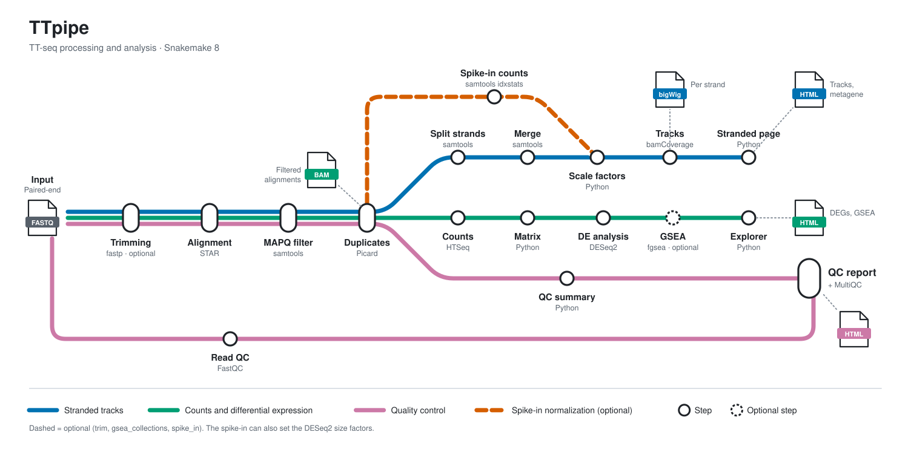

# Overview {.unnumbered}

**TTpipe** turns TT-seq (TTchem-seq) sequencing data (FASTQ files) into
alignments, strand-specific bigWig tracks, per-gene counts over the whole
gene body, differential expression (DESeq2), gene-set enrichment (fgsea), a
Sankey diagram, and a one-page QC report that tells you whether the
libraries look sane. It is run with Snakemake 8 on a SLURM cluster or on
one machine, driven by a samplesheet and a config file, and follows the
layout of the PhanstielLab
[dietJuicer](https://github.com/PhanstielLab/dietJuicer) pipeline and the
author's MicroCPipe.

::: {.callout-note}
**Where it comes from.** TTpipe is a **reimplementation** of the TT-seq
workflow described in a pipeline guide for Magnitov et al. 2024, *Mol
Cell* ([doi 10.1016/j.molcel.2024.11.031](https://doi.org/10.1016/j.molcel.2024.11.031);
data GEO [GSE260914](https://www.ncbi.nlm.nih.gov/geo/query/acc.cgi?acc=GSE260914);
the authors' code is at <https://github.com/magnitov/zfp143>). It is **not
the authors' code.** The tools and parameters follow the guide; the places
where TTpipe deliberately does something different are listed in
[Configuration](configuration.qmd#deliberate-changes-from-the-source-guide).
The scale factors the guide quotes come from the authors' repository.
:::

The test runs on real data are recorded in [Validation status](validation.qmd).

::: {.callout-note}
**Included example.** The shipped samplesheet and config describe the eight
TT-seq samples of GSE260914 (mouse embryonic stem cells, ZFP143 dTAG
degradation; DMSO, 2 h, 6 h and 24 h, two replicates each), with paths you
must replace (`/path/to/fastq/`, `/path/to/GRCm38...`). The
[Vignette](vignette.qmd) walks through it.
:::

## How the pieces fit together

```
  samplesheet.txt                                config/TTpipeConfig.yaml
  (one row per sample: Name, Condition,          (reference, strandedness, tracks,
   Replicate, Read1, Read2, directory)            counts, DESeq2, GSEA, QC thresholds)
          │                                                │
          └──────────────────────┬─────────────────────────┘
                                 ▼
                    workflows/TTpipe.snakefile
                                 │
   run_processing:   FastQC [-> fastp] -> STAR -> MAPQ filter -> Picard dedup
                                 │
                     split into forward / reverse strand BAMs
                       │                          │
       merge replicates per condition       HTSeq-count per sample and strand
       -> scale factors -> bigWigs                │
                                          counts_forward / counts_reverse
                                          -> counts_deseq2.txt   (sum or sense)
                                 │
   run_analysis:     DESeq2 (every comparison) -> rank list -> fgsea
                                 │                  └─> Sankey, PCA
   qc_report:        qc_summary -> TTpipe_qc_report.html     [multiqc -> TTpipe_multiqc.html]
                                 ▼
                    <outputDir>/…
```

A **sample** is one samplesheet row (one pair of FASTQ files). A
**condition** is a group of samples that are replicates of each other (for
example `DMSO`, `2H`, `6H`, `24H`). Samples are processed one by one; the
replicates of a condition are merged only for the bigWig tracks, and DESeq2
uses every sample separately.

## The pipeline at a glance

{fig-alt="TTpipe subway map: FASTQ to alignment, filtering and duplicate removal, then stranded tracks, counts and differential expression, and quality control, with optional trimming, GSEA and spike-in normalization."}

Each coloured line is a branch of the pipeline and each stop a step; dashed
stops and lines are optional. The map is drawn with
[slitherFlow](https://github.com/mikemartinez99/slitherFlow) from
`img/ttpipe_subway.yaml`.

### The rule graph {#the-rule-graph}

The detailed version below has one box per Snakemake rule and one arrow per
dependency. An arrow that ends on a coloured stage box means the rule feeds several
rules of that stage (for example, most steps feed the QC report). The diagrams below are
generated from the real Snakefile by `python scripts/make_dag.py` (which
runs `snakemake --rulegraph`); re-run it after changing a rule, and never
edit the diagram files by hand.

The **full workflow**, with every optional branch switched on (`trim`,
`build_star_index`, `sample_tracks`, a GSEA collection and MultiQC):

::: {.callout-note collapse="true"}
## Show the rule-by-rule graph

```{mermaid}
%%| file: img/dag_full.mmd
```
:::

The **processing-only** graph (`run_analysis: false`) and the
**analysis-only** graph (`run_processing: false`) are on the
[Running chapter](running.qmd#running-only-part-of-the-workflow).

## What you get

| Output | Where | What it is |
|--------|-------|------------|
| QC report | `qc/TTpipe_qc_report.html` | Traffic lights per sample, alignment, strandedness, rRNA, correlation, PCA |
| MultiQC page | `qc/TTpipe_multiqc.html` | FastQC, fastp, STAR and Picard summaries in MultiQC's standard layout |
| BAMs | `<sample>/<sample>.bam`, `_forward.bam`, `_reverse.bam` | MAPQ-filtered, deduplicated, per strand |
| Tracks | `tracks/<condition>[_forward\|_reverse].bw` | Scaled bigWigs for a genome browser |
| Counts | `counts/counts_deseq2.txt` and the per-strand matrices | Whole-gene-body counts, gene by sample |
| Differential expression | `analysis/deseq2/degs_<treatment>_vs_<reference>.csv` | Full DESeq2 table per comparison |
| GSEA | `analysis/gsea/<collection>_<comparison>.tsv` | fgsea results per gene-set collection |
| Figures | `analysis/figures/pca.pdf`, `sankey.pdf` | PCA and Sankey |

## How to read this book

- New to TT-seq? Start with [From Reads to Results](journey.qmd).
- Want one worked example from an empty directory? [Vignette](vignette.qmd).
- Ready to run on your data? [Setup](setup.qmd), then [Running](running.qmd).
- Judging a run: [Reading the QC report](qc.qmd) and
  [Differential expression and GSEA](analysis.qmd).
- Changing behaviour: [Recipes](recipes.qmd), [Configuration](configuration.qmd)
  and [Cluster reference](cluster.qmd).

The repository also holds [`CODE_GUIDE.md`](https://github.com/jpflores-13/TTpipe/blob/main/CODE_GUIDE.md),
a rule-by-rule description of the code.
